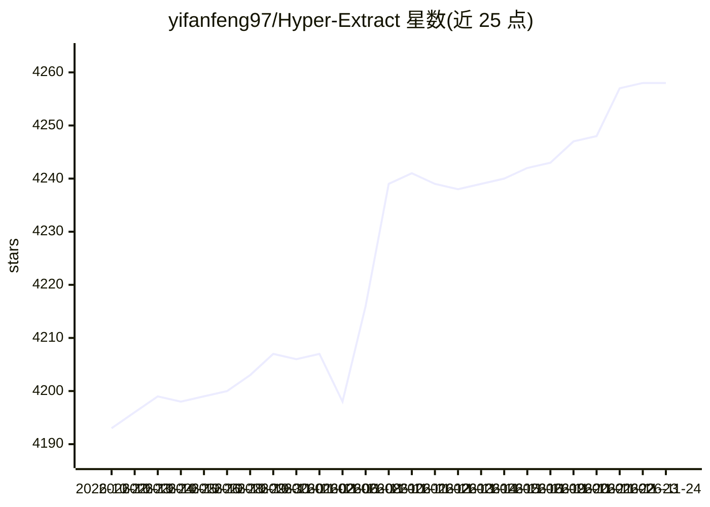

# yifanfeng97/Hyper-Extract

⭐ 4,258 · Python · NOASSERTION · 推送 2026-11-05 · [GitHub](https://github.com/yifanfeng97/Hyper-Extract) · [官网](https://yifanfeng97.github.io/Hyper-Extract/) · 个人维护 · 中文 README

**用 LLM 将文档一键抽取为图/超图等结构化知识的 CLI**

Python CLI 与库，输入 PDF、Word、PPT、Excel、HTML、EPUB 等文档，通过模板驱动的方式用 LLM 抽取出 9 种结构（列表、图、超图、时空图等），支持增量更新、来源溯源、回滚与 Obsidian 导出。抽取引擎含 chunk_rag、GraphRAG、LightRAG、Hyper-RAG、KG-Gen 等 11+ 种；提供 80+ YAML 模板覆盖金融、法律、医疗、中医、工业等领域。依赖支持 function calling 的模型；本地部署需 vLLM 与 GPU；另提供只读 MCP Server。Apache-2.0 许可。

## 筛选速览

| 维度 | 判定 | 备注 |
|---|---|---|
| AI 角色 | `ai-native` | 本体是模型或模型工具 |
| 许可风险 | `none` | NOASSERTION |
| 部署形态 | `library` | 以包/库形式分发 |
| 模型依赖 | local-ok | 支持本地模型 |
| 硬件要求 | — | 无带数字的原话,不猜 |
| 安装摩擦 | `low` | 无编译、无系统依赖或容器化 |
| 成熟度 | — | 结构信号不足 |

## 能力要点

- 9 种知识结构：从 chunk 语料到图、超图、时空图
- 11+ 抽取引擎（GraphRAG/LightRAG/Hyper-RAG/KG-Gen 等）
- 80+ YAML 模板覆盖金融、法律、医疗、中医等 6 领域
- 增量更新与来源溯源：审计、回滚、upsert

## 适用场景

- 把论文转成含概念、作者、引用关系的知识图谱
- 从财报中抽取公司、高管、财务指标及关系
- 本地部署 vLLM 让文档数据不出内网
- 用 Obsidian vault 浏览抽取出的知识网络

## 场景标签

`知识图谱` `文档解析` · 领域:知识与检索

## 证据(README 行号)

> L9: **Transform documents into structured knowledge with one command.**
> L74: # Extract knowledge from a document
> L102: |🔷 **9 Knowledge Structures**|From raw chunk corpora and simple Lists to advanced Graphs, Hypergraphs, and Spatio-

## 星数曲线

2026-10-22 4,193 → 2026-11-24 4,258（+65）

---
*卡片 v1 · prompt 1.4 · 生成 2026-11-23 · 置信度 high · 依据 README sha `426a81a2411a` · [字段定义](../../DATASET.md)*
