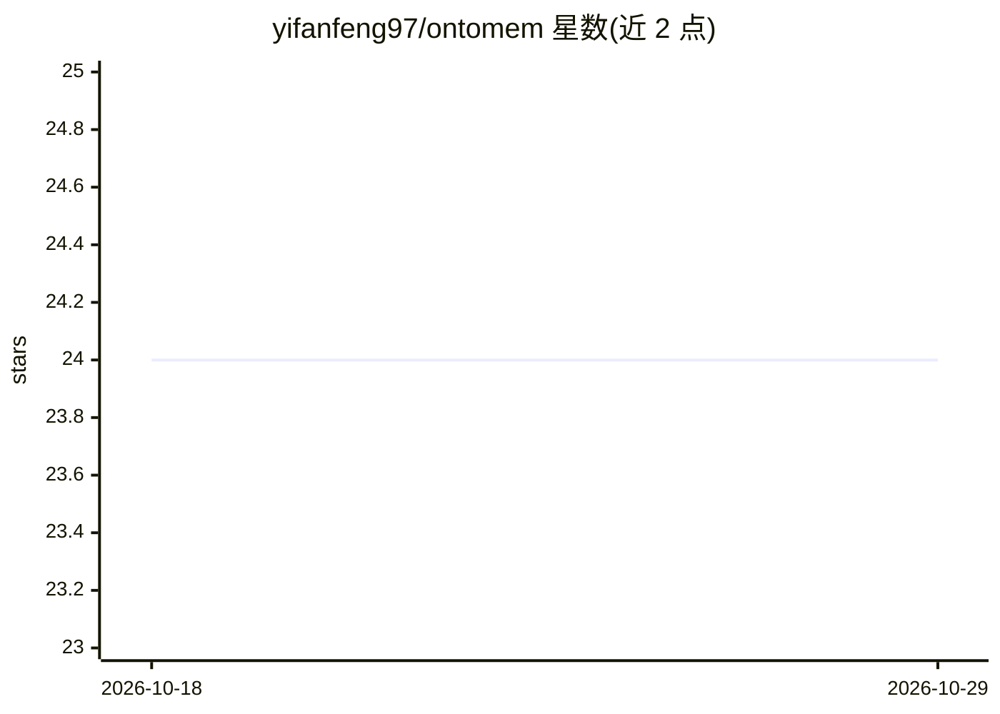

# yifanfeng97/ontomem

⭐ 24 · Python · NOASSERTION · 推送 2026-09-29 · [GitHub](https://github.com/yifanfeng97/ontomem) · [官网](https://yifanfeng97.github.io/ontomem/) · 个人维护 · 中文 README

**给 AI agent 开发者的自整合结构化记忆库**

OntoMem 是面向 AI agent 开发者的 Python 记忆库：以 Pydantic schema 存储强类型结构化实体（而非文本片段），通过组合键将碎片化观察聚合为会话/日度摘要，并提供 FAISS 向量语义检索、O(1) 二级索引 Lookup 与键值精确访问。冲突合并支持字段合并、新旧保留及 LLM 语义合成（BALANCED/PREFER/CUSTOM_RULE）多种策略，LLM 批量调用可用 max_workers 控制并发。支持来源账本按文档回滚、FAISS 索引增量维护与状态持久化到磁盘。LLM 合并路径依赖外部模型（示例使用 langchain_openai）。

## 筛选速览

| 维度 | 判定 | 备注 |
|---|---|---|
| AI 角色 | `ai-ecosystem` | LLM/agent 周边工具 |
| 许可风险 | `none` | NOASSERTION |
| 部署形态 | `library` | 以包/库形式分发 |
| 模型依赖 | — | README 未给出锁定关系 |
| 硬件要求 | — | 无带数字的原话,不猜 |
| 安装摩擦 | `low` | 无编译、无系统依赖或容器化 |
| 成熟度 | — | 结构信号不足 |

## 能力要点

- Pydantic schema 强类型记忆实体与智能合并为 Golden Record
- 组合键时间切片：碎片事件聚合为单一日度/会话摘要
- FAISS 向量检索 + 键值 O(1) 精确访问 + 自定义维度 Lookup 混合查询
- 来源账本支持按文档精确回滚（remove_source/upsert_source）

## 适用场景

- 为长期运行的 agent 维护连贯的用户画像与知识档案
- 将日志/对话流聚合为结构化的每日摘要记录
- 跨时间线按实体名、位置等维度做快速查询

## 场景标签

`Agent 记忆` · 领域:Agent 开发

## 证据(README 行号)

> L18: Traditional RAG (Retrieval-Augmented Generation) systems retrieve text fragments. **OntoMem** maintains **structure
> L126: |Feature|**OntoMem** 🧠|**Mem0** / Zep|**LangChain Memory**|**Vector DBs** (Pinecone/Chroma)|

## 星数曲线

2026-10-18 24 → 2026-10-29 24（+0）

---
*卡片 v1 · prompt 1.4 · 生成 2026-10-27 · 置信度 high · 依据 README sha `7c8df66cc2a1` · [字段定义](../../DATASET.md)*
