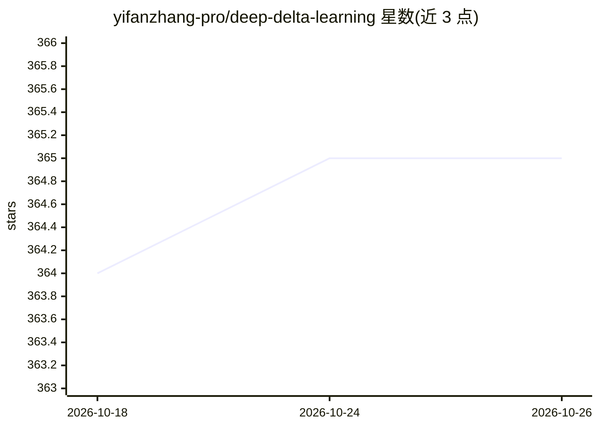

# yifanzhang-pro/deep-delta-learning

⭐ 365 · Python · Apache-2.0 · 推送 2026-09-25 · [GitHub](https://github.com/yifanzhang-pro/deep-delta-learning) · [官网](https://yifanzhang-pro.github.io/deep-delta-learning) · 组织维护

**Transformer 残差更新机制研究代码：DDL 结构化残差编辑**

论文 Deep Delta Learning 的官方项目页代码：提出一种 Transformer 残差流的深度方向 delta 规则更新，每层沿学习方向读取残差状态、与学习目标比较、写回门控 rank-1 修正；门控关闭恢复恒等映射，门控为 1 时精确覆写读出值。提供标量与扩展残差状态两种实例及 TC/CC/EC 变体，模型为 Hugging Face PreTrainedModel 形式的 PyTorch 实现，含 Triton 加速版本。需 Python 3.14，加速版需 CUDA GPU，参考实现可 CPU 运行。论文自述实验为单次运行点估计，扩展状态变体牺牲吞吐与峰值内存。

## 筛选速览

| 维度 | 判定 | 备注 |
|---|---|---|
| AI 角色 | `ai-native` | 本体是模型或模型工具 |
| 许可风险 | `permissive` | Apache-2.0 |
| 部署形态 | `None` |  |
| 模型依赖 | — | README 未给出锁定关系 |
| 硬件要求 | — | 无带数字的原话,不猜 |
| 安装摩擦 | `medium` | 含编译或系统依赖之一 |
| 成熟度 | — | 结构信号不足 |

## 能力要点

- 沿学习方向的门控 rank-1 残差读写更新（深度方向 delta 规则）
- 扩展残差状态在不加宽主干的情况下增加状态容量
- 提供参考实现与 Triton 加速实现共 12 个模型文件
- 模型实现为 Hugging Face PreTrainedModel（GPTConfig/GPT）

## 适用场景

- 复现论文中的 ~124M/~353M 预训练实验
- 研究 Transformer 残差流的替代接口结构
- 在自有语言模型训练中试验 DDL 子层变体

## 场景标签

`模型训练` · 领域:训练与推理

## 证据(README 行号)

> L13: **Deep Delta Learning (DDL)** is a residual update for Transformers. Each layer reads the residual state along a le
> L21: Transformer residual streams evolve through additive updates. A sufficiently expressive residual block can represen
> L74: `model/` contains the PyTorch implementations of the language models in the paper. Each model file defines a `GPTCo

## 星数曲线

2026-10-18 364 → 2026-10-26 365（+1）

---
*卡片 v1 · prompt 1.4 · 生成 2026-10-21 · 置信度 high · 依据 README sha `e493b45a61d7` · [字段定义](../../DATASET.md)*
