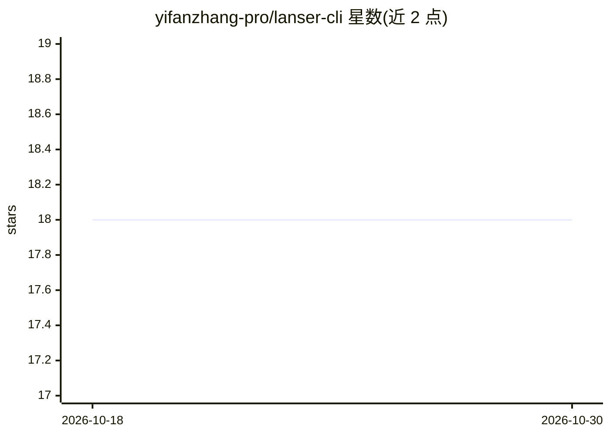

# yifanzhang-pro/lanser-cli

⭐ 18 · Python · Apache-2.0 · 推送 2026-06-15 · [GitHub](https://github.com/yifanzhang-pro/lanser-cli) · [官网](https://yifanzhang-pro.github.io/lanser-cli/) · 个人维护

**让编码 agent 接入编译器/语言服务器反馈的 CLI 编排层**

Lanser-CLI 是论文 RLCSF（Reinforcement Learning from Compiler and Language Server Feedback）的参考实现：通过 CLI 编排固定版本的编译器与语言服务器（Pyright），将诊断、符号解析、类型、引用、重命名等结果转为确定性的可回放 JSON/JSONL 分析工件，供编码 agent 与 CI 使用。提供多种选择器 DSL、预览优先的受保护变更流程，并基于相邻工件计算诊断差分等过程奖励信号，用于强化学习与离线过程监督。需要 Python 3.12+，语言服务器支持以 Pyright 为主。

## 筛选速览

| 维度 | 判定 | 备注 |
|---|---|---|
| AI 角色 | `ai-ecosystem` | LLM/agent 周边工具 |
| 许可风险 | `permissive` | Apache-2.0 |
| 部署形态 | `None` |  |
| 模型依赖 | — | README 未给出锁定关系 |
| 硬件要求 | — | 无带数字的原话,不猜 |
| 安装摩擦 | `low` | 无编译、无系统依赖或容器化 |
| 成熟度 | — | 结构信号不足 |

## 能力要点

- 将编译器/LSP 反馈转为确定性、可回放的分析 bundle（SHA-256 稳定哈希）
- 多种选择器形式：坐标、符号、AST 路径、内容锚点，显式编码语义
- RLCSF 过程奖励：由诊断差分、选择器置信度、安全就绪度与工具错误计算
- 变更操作默认干跑预览，含路径隔离、脏工作树守卫与冲突检测

## 适用场景

- 为编码 agent 提供基于语言服务器事实的接地信号
- 在 CI 中做可回放的门禁与回归测试
- 构建强化学习/过程监督训练所需的过程奖励数据集

## 场景标签

`强化学习` · 领域:训练与推理

## 证据(README 行号)

> L10: `Lanser-CLI` is a CLI-first orchestration layer for grounding coding agents in
> L15: Lanser-CLI is the reference implementation for **Reinforcement Learning from

## 星数曲线

2026-10-18 18 → 2026-10-30 18（+0）

---
*卡片 v1 · prompt 1.4 · 生成 2026-10-29 · 置信度 high · 依据 README sha `3c5e416cc3df` · [字段定义](../../DATASET.md)*
