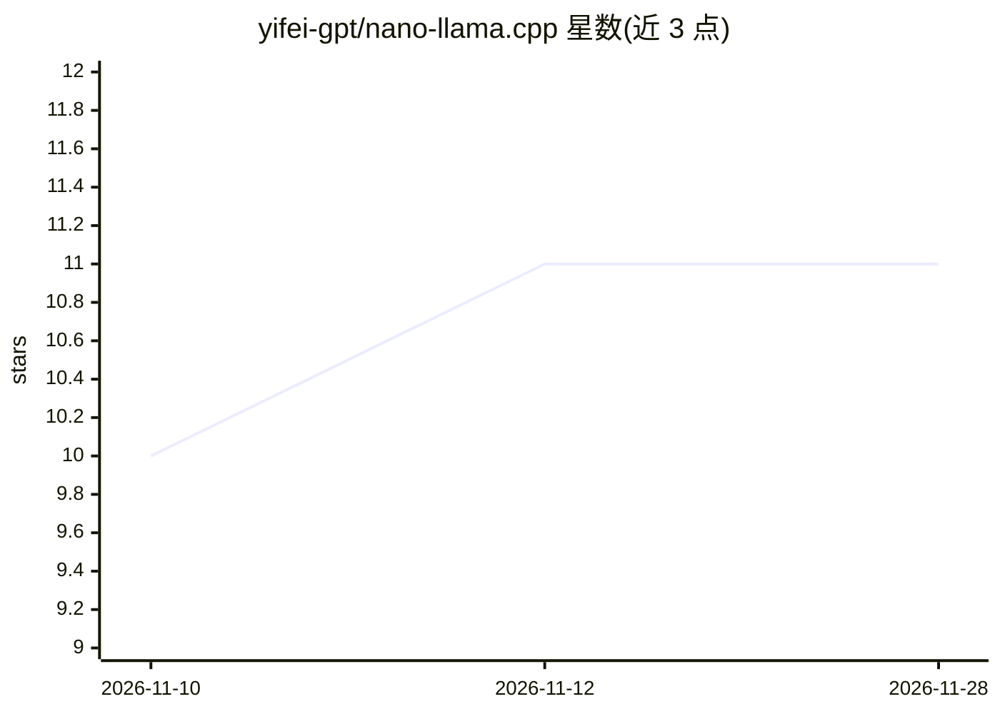

# yifei-gpt/nano-llama.cpp

⭐ 11 · C++ · MIT · 推送 2026-06-03 · [GitHub](https://github.com/yifei-gpt/nano-llama.cpp) · 个人维护

**为开发者提供的轻量 C++/CUDA LLM 推理引擎**

用约 2,730 行 C++ 编写的 LLM 推理引擎，内核来自裁剪版 ggml，模型、分词器、KV/recurrent 缓存、采样器、视觉编码器与服务端均在本仓库实现。支持 GGUF 格式的 Qwen3（dense）与 Qwen3.5（gated-DeltaNet+attention 混合架构，带视觉输入），同一代码可在 CPU 或单 GPU 上运行，GPU 路径使用 flash-attention 与 CUDA-graph replay。提供 CLI、基准工具与支持 OpenAI 兼容端点、流式输出和 continuous batching 的服务器，并附 AGENTS.md 指导添加自定义模型与算子。

## 筛选速览

| 维度 | 判定 | 备注 |
|---|---|---|
| AI 角色 | `ai-ecosystem` | LLM/agent 周边工具 |
| 许可风险 | `permissive` | MIT |
| 部署形态 | `None` |  |
| 模型依赖 | — | README 未给出锁定关系 |
| 硬件要求 | `cpu-ok` | |
| 安装摩擦 | `high` | 编译与系统依赖俱全 |
| 成熟度 | — | 结构信号不足 |

## 能力要点

- ~2,730 行 C++ 实现，内核来自 vendored ggml 裁剪副本
- 内置 ViT 视觉编码器，CLI（--image）与服务端均支持图像输入
- OpenAI 兼容 /v1/chat/completions + /completion 端点，continuous batching 服务端
- 同一代码支持 CPU 与 CUDA 后端，附基准工具 nano-bench

## 适用场景

- 在 CPU 或单 GPU 上运行 Qwen3/Qwen3.5 的 GGUF 模型
- 部署提供 OpenAI 兼容接口的多并发推理服务
- 阅读小型代码库学习 LLM 推理引擎实现
- 按 AGENTS.md 指南添加自定义模型与算子

## 场景标签

`推理引擎` · 领域:训练与推理

## 证据(README 行号)

> L5: A small, readable LLM inference engine in C++/CUDA — GGUF, on CPU or a single GPU. Runs **Qwen3**
> L17: - 🔀 **Continuous-batching server** — OpenAI-compatible `/v1/chat/completions` + `/completion` with streaming; multi
> L18: - 🖥️ **Backend support** — the same code runs on CPU or CUDA; the GPU path uses flash-attention and CUDA-graph repl

## 星数曲线

2026-11-10 10 → 2026-11-28 11（+1）

---
*卡片 v1 · prompt 1.4 · 生成 2026-11-18 · 置信度 high · 依据 README sha `32eeffbf7a45` · [字段定义](../../DATASET.md)*
