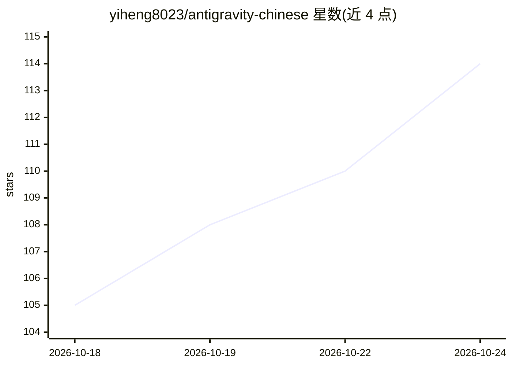

# yiheng8023/antigravity-chinese

⭐ 114 · JavaScript · MIT · 推送 2026-10-22 · [GitHub](https://github.com/yiheng8023/antigravity-chinese) · 个人维护 · 中文 README

**Google Antigravity 全生态客户端与扩展的中文本地化套件**

为 Google Antigravity 桌面客户端 2.0、VS Code 官方扩展、独立 IDE 与插件/技能生态提供可逆式中文化：通过 Electron ASAR 注入、CDP 免解包热挂载、IPC 菜单拦截与 Webview 本地反向代理实现界面汉化，CLI 保持原生英文。内置双重备份、原子回滚、防降级熔断与官方中文让位机制。要求 Node.js ≥18 与已安装的 Antigravity 组件，安装器按弹性探测只对已装部分注入。提供 Windows/macOS/Linux 安装脚本与 CLI 管理器。

## 筛选速览

| 维度 | 判定 | 备注 |
|---|---|---|
| AI 角色 | `ai-ecosystem` | LLM/agent 周边工具 |
| 许可风险 | `permissive` | MIT |
| 部署形态 | `library` | 以包/库形式分发 |
| 模型依赖 | — | README 未给出锁定关系 |
| 硬件要求 | — | 无带数字的原话,不猜 |
| 安装摩擦 | `low` | 无编译、无系统依赖或容器化 |
| 成熟度 | — | 结构信号不足 |

## 能力要点

- ASAR 深度注入 + CDP 免解包热挂载双模式汉化桌面客户端
- VS Code 扩展 Webview 本地反向代理实现设置面板与聊天界面汉化
- 双重备份、两阶段原子回滚与版本防降级熔断
- 390+ 项自动化回归测试与跨平台 CI 矩阵

## 适用场景

- 把 Antigravity 桌面客户端与 VS Code 扩展界面切换为中文
- 在上游版本更新后自动检测词典漂移并回滚/重注入
- 需要还原官方英文原版时一键无损卸载

## 场景标签

 · 领域:开发工具/本地化

## 证据(README 行号)

> L14: 专为 **Google Antigravity** 全生态（桌面客户端 2.0、独立 IDE 与第三方 IDE 扩展、CLI 命令行工具）打造的高性能、可逆式中文本地化套件与生命周期管理器（当前版本 **v3.3.24**，全面深
> L20: |🖥️ **桌面客户端 (Desktop App 2.0)**|独立 Electron 客户端，包含全局看板、白板与 Aux Pane|ASAR 深度注入 / CDP 免解包热挂载 + IPC 上下文菜单拦截|🟢 **100% 满
> L31: - 🧩 **VS Code 官方扩展全景汉化与 Webview 深度注入闭环 (VS Code Extension Full Localization & Webview Proxy)**：

## 星数曲线

2026-10-18 105 → 2026-10-24 114（+9）

---
*卡片 v1 · prompt 1.4 · 生成 2026-10-23 · 置信度 low · 依据 README sha `a637f5070f36` · [字段定义](../../DATASET.md)*
