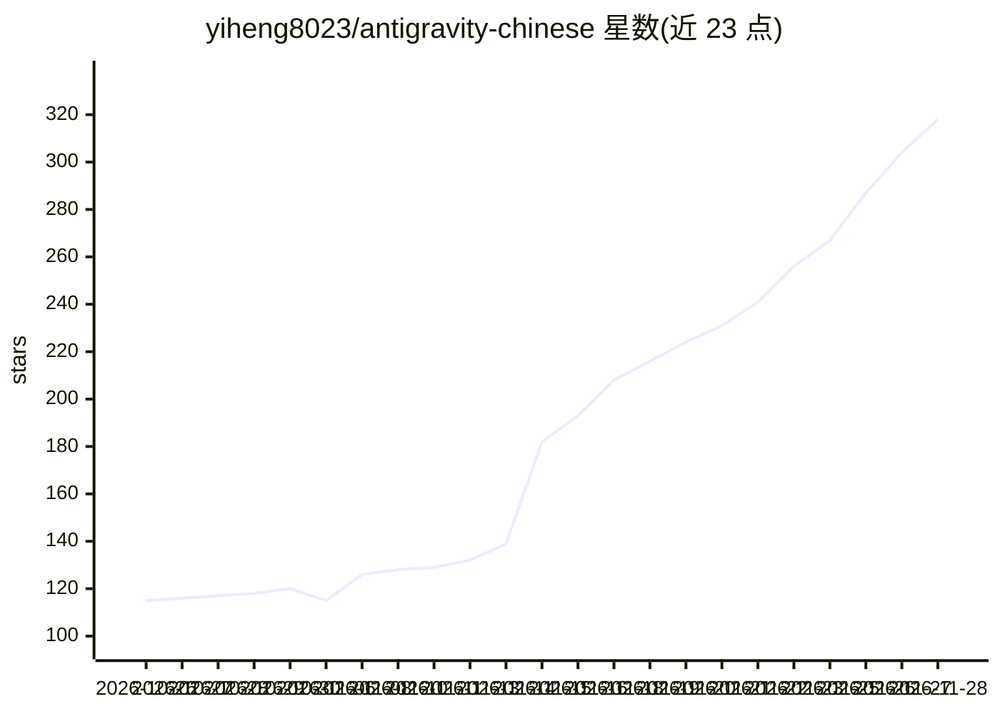

# yiheng8023/antigravity-chinese

⭐ 318 · JavaScript · MIT · 推送 2026-11-27 · [GitHub](https://github.com/yiheng8023/antigravity-chinese) · 个人维护 · 中文 README

**为中文用户汉化 Google Antigravity 桌面客户端与 VS Code 扩展**

社区开源的本地化套件，通过对客户端 ASAR preload、原生菜单和弹窗打补丁实现中文化，覆盖 Antigravity App 桌面端与 VS Code 扩展，提供备份还原、安装副本校验和可选的社区中文交互插件；不修改 CLI 二进制，独立 IDE 不声明适配。以 Node.js CLI（cli.js）与 install.sh/install.bat 脚本分发，配套词库构建、自动化测试与前端文本扫描工具。官方更新后需重新执行安装，扩展更新会覆盖汉化。

## 筛选速览

| 维度 | 判定 | 备注 |
|---|---|---|
| AI 角色 | `ai-enhanced` | 去掉 AI 部分产品仍成立 |
| 许可风险 | `permissive` | MIT |
| 部署形态 | `library` | 以包/库形式分发 |
| 模型依赖 | — | README 未给出锁定关系 |
| 硬件要求 | — | 无带数字的原话,不猜 |
| 安装摩擦 | `low` | 无编译、无系统依赖或容器化 |
| 成熟度 | — | 结构信号不足 |

## 能力要点

- ASAR preload/菜单/弹窗文本补丁，含版本备份与还原
- 支持 Linux 便携解压版与 VS Code Server 扩展路径自动探测
- 内容保护机制：消息正文、文件树、自定义扩展内容保留原文
- 提供词库构建、13 套自动化测试与前端文本漂移扫描

## 适用场景

- 给 Antigravity 桌面客户端安装中文界面补丁
- 汉化 VS Code 上的 Antigravity 扩展及远程 .vscode-server 场景
- 官方版本更新后重新安装并还原适配的汉化

## 场景标签

 · 领域:开发工具/本地化

## 证据(README 行号)

> L16: 这是社区开源项目，提供桌面客户端与 VS Code 扩展的本地中文补丁、备份还原，以及可选的中文交互插件。Google 官方及合作伙伴目录中已核实的短介绍，在市场、精选、已安装、详情和设置中复用同一译文。插件名、发布者提供的命令与
> L24: |Antigravity App|ASAR preload、原生菜单和弹窗文本补丁；版本备份与还原|Windows x64 2.36.0 的原版前端核对、界面回归和安装副本验证。Linux x64 2.33.0 的安装验证见便携安
> L34: 需要 Node.js **>=18** 及 npm/npx。首次安装开发依赖或 ASAR 工具可能需要联网。先保存工作并正常退出客户端，再在仓库目录运行：

## 星数曲线

2026-10-26 115 → 2026-11-28 318（+203）

---
*卡片 v1 · prompt 1.4 · 生成 2026-11-28 · 置信度 high · 依据 README sha `0773cf5d63d4` · [字段定义](../../DATASET.md)*
