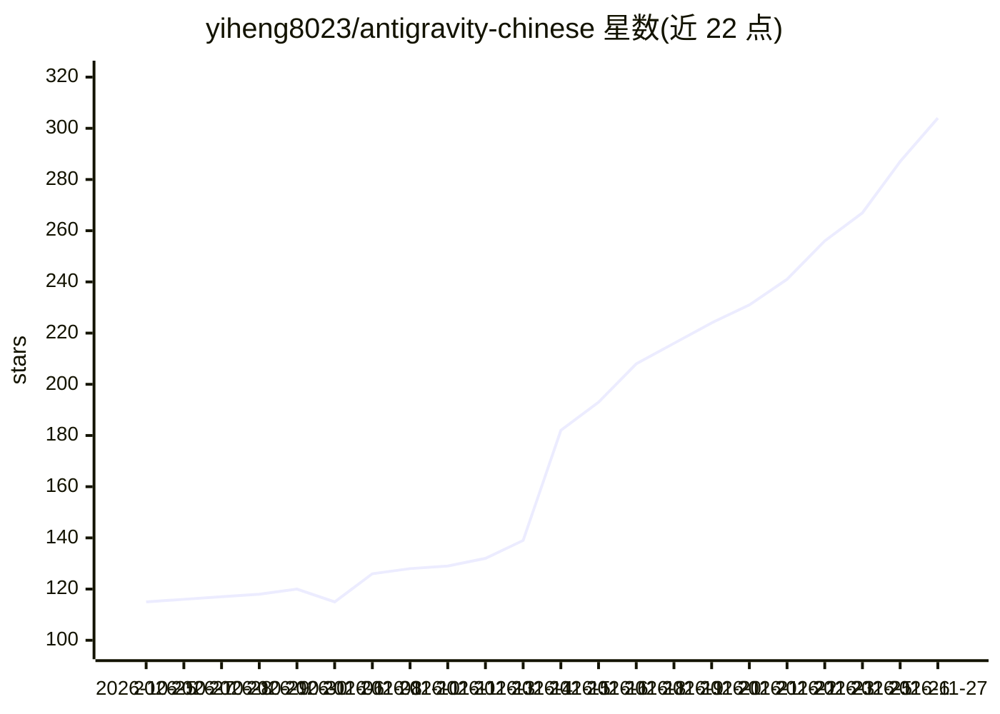

# yiheng8023/antigravity-chinese

⭐ 304 · JavaScript · MIT · 推送 2026-11-26 · [GitHub](https://github.com/yiheng8023/antigravity-chinese) · 个人维护 · 中文 README

**Google Antigravity 桌面端与扩展的中文汉化补丁工具**

社区开源的本地化工具，通过 ASAR preload、原生菜单与弹窗文本补丁为 Antigravity 桌面客户端打中文补丁，并提供 VS Code 扩展的清单、菜单与通知翻译及 Webview 本地代理；支持安装前备份与还原、可选社区中文插件、Linux 便携目录探测与自定义路径安装。验证范围限定在 Windows x64 桌面 2.35.2 与扩展 1.13.0；扩展更新会覆盖汉化，需重新执行安装命令。

## 筛选速览

| 维度 | 判定 | 备注 |
|---|---|---|
| AI 角色 | `ai-ecosystem` | LLM/agent 周边工具 |
| 许可风险 | `permissive` | MIT |
| 部署形态 | `library` | 以包/库形式分发 |
| 模型依赖 | — | README 未给出锁定关系 |
| 硬件要求 | — | 无带数字的原话,不猜 |
| 安装摩擦 | `low` | 无编译、无系统依赖或容器化 |
| 成熟度 | — | 结构信号不足 |

## 能力要点

- 桌面客户端 ASAR/菜单补丁 + VS Code 扩展汉化双路径
- 安装前备份、restore 还原与逐文件比对机制
- 词库构建、自动化测试（13 套入口）与漂移扫描脚本
- 不分发官方二进制资产，全部修改在用户本地完成

## 适用场景

- 为中文用户汉化 Antigravity 桌面客户端和 VS Code 扩展
- 官方更新后重新应用与核对汉化
- 需要回退到原版时用备份还原功能恢复客户端

## 场景标签

 · 领域:开发工具/本地化

## 证据(README 行号)

> L16: 这是社区开源项目，提供桌面客户端与 VS Code 扩展的本地中文补丁、备份还原，以及可选的中文交互插件。Google 官方及合作伙伴目录中已核实的短介绍，在市场、精选、已安装、详情和设置中复用同一译文。插件名、发布者提供的命令与
> L24: |Antigravity App|ASAR preload、原生菜单和弹窗文本补丁；版本备份与还原|Windows x64 2.35.2 安装、重复安装、还原、外置文件核验及部分界面实测。Linux x64 2.33.0 的安装验

## 星数曲线

2026-10-25 115 → 2026-11-27 304（+189）

---
*卡片 v1 · prompt 1.4 · 生成 2026-11-26 · 置信度 mid · 依据 README sha `447fdf954a1b` · [字段定义](../../DATASET.md)*
