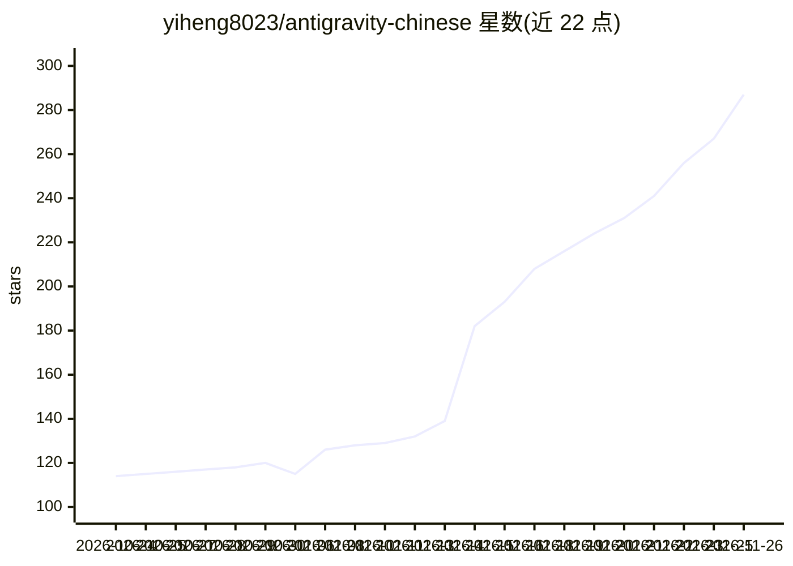

# yiheng8023/antigravity-chinese

⭐ 287 · JavaScript · MIT · 推送 2026-11-25 · [GitHub](https://github.com/yiheng8023/antigravity-chinese) · 个人维护 · 中文 README

**为 Google Antigravity 桌面端与 VS Code 扩展提供中文汉化补丁**

社区开源的本地化套件，通过 ASAR preload、原生菜单与通知文本补丁为 Antigravity 桌面客户端（2.34.0）及 VS Code 扩展（1.13.0）提供简体中文界面，附带备份还原机制，官方更新覆盖汉化后需重新执行安装命令。提供 CLI（install/status/restore/install:vscode）与 install.bat/install.sh 脚本，支持 --path 指定自定义安装目录与 Linux 便携版路径探测；词库由 dict/src 源文件构建，带自动化测试与漂移扫描工具。实测验证范围为 Windows x64，macOS/Linux 为跨平台自动化验证。

## 筛选速览

| 维度 | 判定 | 备注 |
|---|---|---|
| AI 角色 | `ai-enhanced` | 去掉 AI 部分产品仍成立 |
| 许可风险 | `permissive` | MIT |
| 部署形态 | `library` | 以包/库形式分发 |
| 模型依赖 | — | README 未给出锁定关系 |
| 硬件要求 | — | 无带数字的原话,不猜 |
| 安装摩擦 | `low` | 无编译、无系统依赖或容器化 |
| 成熟度 | — | 结构信号不足 |

## 能力要点

- 桌面客户端 ASAR preload、原生菜单与弹窗文本补丁，附版本备份与还原
- VS Code 扩展汉化含清单、通知翻译与 Webview 本地代理
- npm run scan:drift 对官方前端 bundle 做候选文本漂移扫描
- 内容保护边界保留消息正文、代码、路径与用户自定义内容不翻译

## 适用场景

- 在中文界面下使用 Antigravity 桌面客户端与 VS Code 扩展
- 官方客户端更新后重新应用汉化并还原备份
- Linux 便携解压版多目录共存时指定目标打补丁

## 场景标签

 · 领域:开发工具/本地化

## 证据(README 行号)

> L14: 当前源码版本 **v3.3.61**，维护目标为 **Antigravity App 2.34.0 / VS Code 扩展 1.13.0**。这是社区开源项目，提供桌面客户端与 VS Code 扩展的本地中文补丁、备份还原，以及
> L24: |Antigravity App|ASAR preload、原生菜单和弹窗文本补丁；版本备份与还原|Windows x64 2.34.0 安装、重复安装、还原与外置文件核验。Linux x64 2.33.0 的安装验证见便携安装记
> L26: |社区中文插件|中文交互规则与维护诊断技能|可选安装；不代表 Google 官方插件|

## 星数曲线

2026-10-24 114 → 2026-11-26 287（+173）

---
*卡片 v1 · prompt 1.4 · 生成 2026-11-25 · 置信度 high · 依据 README sha `dec76159d64a` · [字段定义](../../DATASET.md)*
