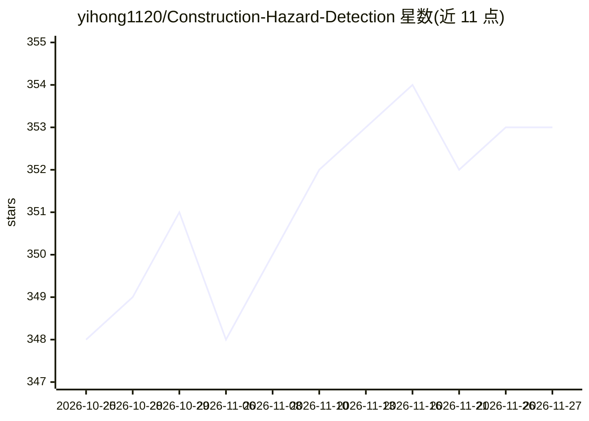

# yihong1120/Construction-Hazard-Detection

⭐ 353 · Python · AGPL-3.0 · 推送 2026-11-20 · [GitHub](https://github.com/yihong1120/Construction-Hazard-Detection) · [官网](https://visionnaire-cda17.web.app/) · 个人维护 · 中文 README

**基于 YOLO 的工地危险行为实时检测与告警系统**

面向建筑工地实时摄像头的 AI 安全监控系统：YOLO worker 进程检测未戴安全帽/反光背心、靠近机械或车辆、进入锥桶围控区域等违规，HDBSCAN 由锥桶坐标生成受控区，Rust/PyO3 后处理做质心跟踪与距离校验，视频经 MediaMTX 分发，事件写入 PostgreSQL 并经 FCM/LINE/Telegram/微信等通道通知。运行时由 FastAPI 服务、Redis 协调、uv 管理依赖，支持 Docker 部署，另含训练、评估、数据增广工具与可选 MCP server。

## 筛选速览

| 维度 | 判定 | 备注 |
|---|---|---|
| AI 角色 | `ai-native` | 本体是模型或模型工具 |
| 许可风险 | `viral` | AGPL-3.0 |
| 部署形态 | `self-host` | docker 或自建部署 |
| 模型依赖 | — | README 未给出锁定关系 |
| 硬件要求 | `cpu-ok` | |
| 安装摩擦 | `low` | 无编译、无系统依赖或容器化 |
| 成熟度 | — | 结构信号不足 |

## 能力要点

- YOLO 检测未戴安全帽/背心、靠近机械、进入锥桶围控区等 5 类危险
- HDBSCAN 聚类锥桶坐标生成受控区域；Rust 后处理可选后端（auto/python/rust）
- 可选 Rust TensorRT INT8 推理后端与 32 路摄像头 IPC 测试
- 通知支持 FCM、LINE、Messenger、Telegram、微信与 HTTP 广播，标签支持 8 种语言

## 适用场景

- 工地摄像头实时识别未佩戴安全帽或反光背心的工人
- 监控工人是否进入锥桶围控的危险区域
- 违规事件自动截图存证并推送多平台通知
- 自建数据集训练与导出 INT8 TensorRT 模型

## 场景标签

`目标检测` · 领域:感知与多模态

## 证据(README 行号)

> L51: AI-assisted construction-site safety monitoring for live cameras. The current
> L59: - Workers without hard hats.
> L150: 5. Local YOLO workers share GPU inference across cameras through shared memory.

## 星数曲线

2026-10-25 348 → 2026-11-27 353（+5）

---
*卡片 v1 · prompt 1.4 · 生成 2026-11-25 · 置信度 high · 依据 README sha `443520a0bb5c` · [字段定义](../../DATASET.md)*
