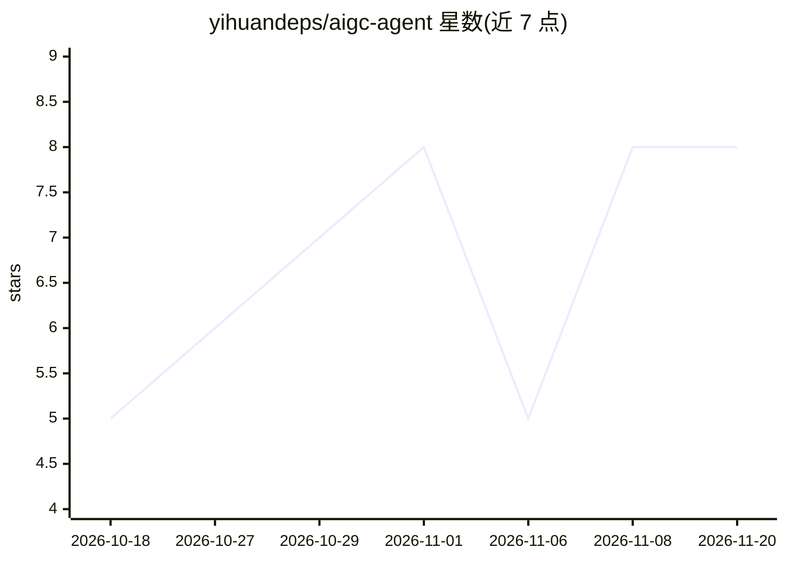

# yihuandeps/aigc-agent

⭐ 8 · Python · MIT · 推送 2026-10-19 · [GitHub](https://github.com/yihuandeps/aigc-agent) · 个人维护 · 中文 README

**给创作者的终端 AIGC Agent：一句创意生成短剧/短视频/海报**

自研 Agent 运行时（harness）加内容生产领域层的 Python CLI 应用：与用户对话后产出短剧成片、抖音短视频、广告片、海报与电商详情页方案。内核不绑定领域，领域能力以 40 多个工具、方法论文档（skill）与流程图挂载。关键机制包括人审挂起（request_review 后主循环暂停等待采纳/打回）、资产版本与血缘回滚、整批报价与项目/日级预算护栏、生成后自动质检门，以及滑窗加压缩的上下文工程。依赖 Python 3.11+、ffmpeg 与多家 API key，作者仅在 Windows 11 实测。

## 筛选速览

| 维度 | 判定 | 备注 |
|---|---|---|
| AI 角色 | `ai-native` | 本体是模型或模型工具 |
| 许可风险 | `permissive` | MIT |
| 部署形态 | `library` | 以包/库形式分发 |
| 模型依赖 | — | README 未给出锁定关系 |
| 硬件要求 | — | 无带数字的原话,不猜 |
| 安装摩擦 | `medium` | 含编译或系统依赖之一 |
| 成熟度 | — | 结构信号不足 |

## 能力要点

- 自研 harness：主循环、权限闸门、成本护栏、事件流，未用 LangChain 等框架
- 人审挂起：用户输入 a/r/j 采纳或打回后继续执行
- 资产带版本与血缘，可 /rollback 回退并复用已成功渲染片段
- 质检门自动校验（人物一致性、单镜时长、引用完整性等）

## 适用场景

- 把一句创意在终端里做成短剧成片
- 从抖音热点关键词生成短视频并配音字幕
- 用产品图生成投放级广告短片与海报
- 对一条抖音链接做爆款归因拆解

## 场景标签

 · 领域:内容创作/AIGC 生产工具

## 证据(README 行号)

> L3: > 从零手搓的 AIGC 内容生产 Agent。在终端里跟它对话，就能把一句创意做成**短剧成片**、**抖音短视频**、**广告片**、**海报**和**电商详情页方案**。
> L10: 它由两部分组成：一个**自己写的 Agent 运行时**（harness：主循环、上下文管理、工具运行时、权限闸门、成本护栏、事件流，没有用 LangChain 之类的框架），加上**长在它上面的内容生产领域层**（短剧、短视频、
> L16: |**短剧**|一句创意，或你自己的剧本|创作方案 → 逐集剧本 → 分镜 → 资产库（角色 / 按场景的服装 / 场景 / 道具 / 音色）→ 参考图 → Seedance 视频提示词 → 并发渲染 → 每集成片 `第01集.m

## 星数曲线

2026-10-18 5 → 2026-11-20 8（+3）

---
*卡片 v1 · prompt 1.4 · 生成 2026-11-20 · 置信度 high · 依据 README sha `5aa5e82d8310` · [字段定义](../../DATASET.md)*
