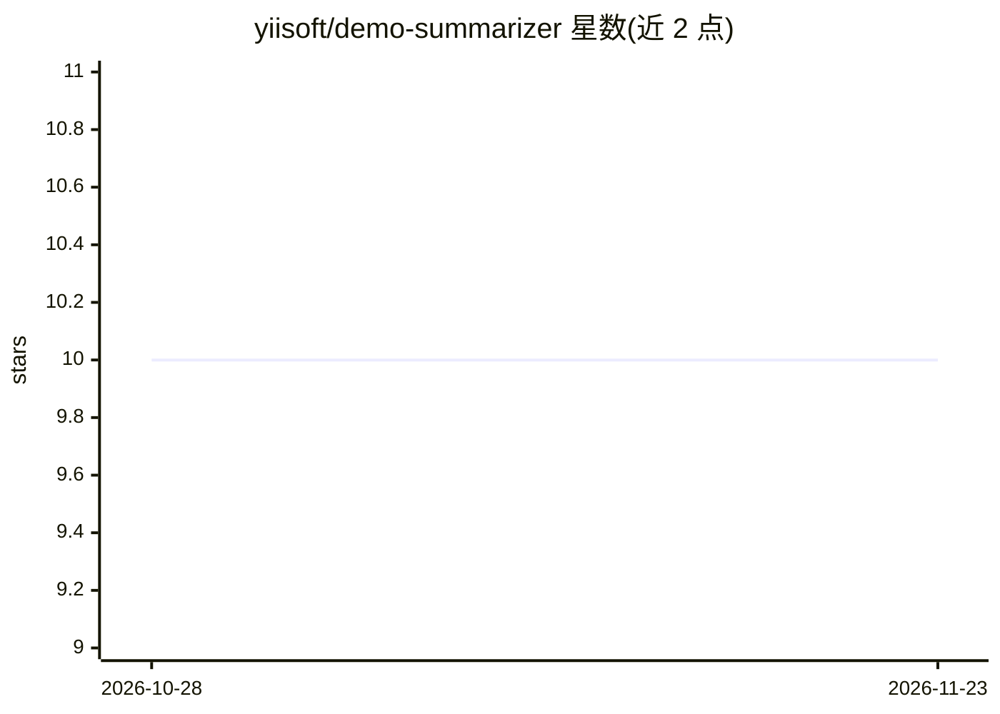

# yiisoft/demo-summarizer

⭐ 10 · PHP · BSD-3-Clause · 推送 2026-11-21 · [GitHub](https://github.com/yiisoft/demo-summarizer) · 组织维护

**Yii3 文档摘要演示应用：上传文档并生成 LLM 摘要**

可运行的 Yii3 演示应用，支持上传 Markdown、文本、HTML、PDF、DOCX 文件，提取可读 markdown 并通过队列处理生成摘要。文件与提取结果存储于 S3 兼容存储，处理进度、重试与删除操作在界面中展示。摘要默认通过内置 llama.cpp Docker 服务在本地运行，可切换 mock 摘要用于测试；也可通过环境变量对接任意 OpenAI 兼容端点。需 Docker 与 make 运行，采用 BSD 许可。

## 筛选速览

| 维度 | 判定 | 备注 |
|---|---|---|
| AI 角色 | `ai-native` | 本体是模型或模型工具 |
| 许可风险 | `permissive` | BSD-3-Clause |
| 部署形态 | `self-host` | docker 或自建部署 |
| 模型依赖 | local-ok | 支持本地模型 |
| 硬件要求 | — | 无带数字的原话,不猜 |
| 安装摩擦 | `low` | 无编译、无系统依赖或容器化 |
| 成熟度 | — | 结构信号不足 |

## 能力要点

- 支持 Markdown/文本/HTML/PDF/DOCX 上传并提取 markdown
- 通过 yiisoft/queue 支持 AMQP、Redis、sync 三种队列模式
- 内置 llama.cpp Docker 服务本地生成摘要，默认 Gemma 3 1B GGUF 模型
- 可对接任意 OpenAI 兼容 chat completions 端点

## 适用场景

- 本地部署一套文档摘要处理流程
- 学习 Yii3 框架的队列、存储与 LLM 集成方式
- 在无外部 API 条件下用本地模型生成文档摘要

## 场景标签

`AI 写作` `文档解析` · 领域:内容生成

## 证据(README 行号)

> L6: A runnable Yii3 demo for uploading documents, extracting readable markdown, summarizing content, and tracking proces
> L152: Local LLM summaries are enabled by default through the OpenAI-compatible `llama.cpp` adapter:

## 星数曲线

2026-10-28 10 → 2026-11-23 10（+0）

---
*卡片 v1 · prompt 1.4 · 生成 2026-11-19 · 置信度 high · 依据 README sha `4601d07d71ae` · [字段定义](../../DATASET.md)*
