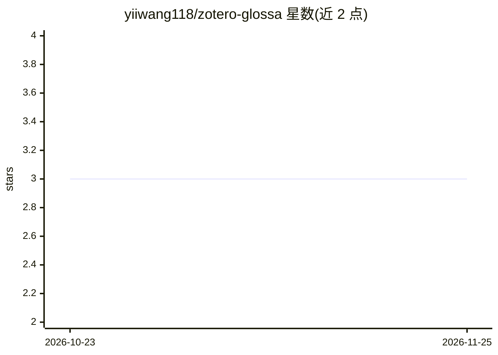

# yiiwang118/zotero-glossa

⭐ 3 · TypeScript · MIT · 推送 2026-11-17 · [GitHub](https://github.com/yiiwang118/zotero-glossa) · 个人维护 · 中文 README

**Zotero 研究助手插件：与论文对话、翻译选区、存为笔记**

嵌入 Zotero 的研究助手插件：与条目论文对话（支持最多六篇对比，读取元数据、摘要、批注、PDF 选区及前 40 页全文），回答以流式 Markdown 呈现并附 [S1] 可点击引用；PDF 选区可即时翻译或追问；LaTeX 公式经 Temml 渲染为 MathML 并存为 Zotero 原生笔记数学格式；回答可保存为子笔记并导出历史。模型服务由用户自备：OpenAI 兼容或 Anthropic API key、本地模型（Ollama、LM Studio），或已登录的 Codex / Claude Code / Grok 命令行工具。限制：无 OCR 与图像理解，上下文上限 60,000 字符，聊天记录不跨机同步。通过 XPI 安装，要求 Zotero 10.0.6+。

## 筛选速览

| 维度 | 判定 | 备注 |
|---|---|---|
| AI 角色 | `ai-native` | 本体是模型或模型工具 |
| 许可风险 | `permissive` | MIT |
| 部署形态 | `None` |  |
| 模型依赖 | local-ok | 支持本地模型 |
| 硬件要求 | — | 无带数字的原话,不猜 |
| 安装摩擦 | `low` | 无编译、无系统依赖或容器化 |
| 成熟度 | — | 结构信号不足 |

## 能力要点

- 回答附 [S1] 可点击引用，可跳转到论文页码或批注
- LaTeX 公式渲染为 MathML 并保存为 Zotero 原生笔记格式
- 支持本地 CLI（Codex / Claude Code / Grok），无需 API key
- PDF 选区快捷翻译与追问，可配置独立翻译服务

## 适用场景

- 在 Zotero 里直接向论文提问并核对引用出处
- 阅读外文 PDF 时划词翻译
- 把带公式和来源链接的回答存为论文子笔记
- 对比阅读多篇论文时提问

## 场景标签

`文档问答` `科研工具` · 领域:知识与检索

## 证据(README 行号)

> L5: A research assistant inside Zotero: chat with your papers, translate PDF selections, and turn answers into Zotero no
> L7: Glossa uses your own model service: an OpenAI-compatible or Anthropic API key, a local model (Ollama, LM Studio), or
> L21: Requires **Zotero 10.0.6 or later 10.x**. Installed copies update automatically from this repository's releases. Te

## 星数曲线

2026-10-23 3 → 2026-11-25 3（+0）

---
*卡片 v1 · prompt 1.4 · 生成 2026-11-21 · 置信度 high · 依据 README sha `6dd45a2fcf53` · [字段定义](../../DATASET.md)*
