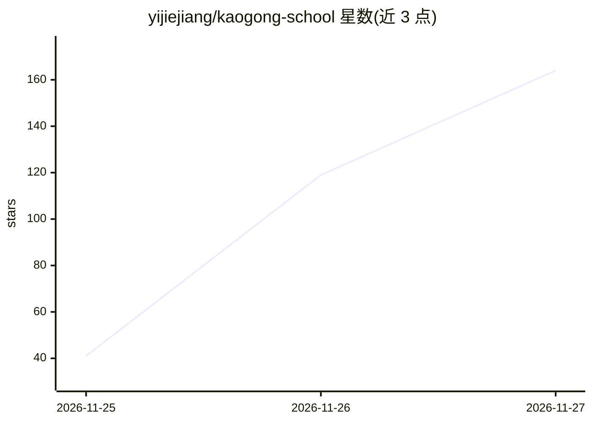

# yijiejiang/kaogong-school

⭐ 164 · Python · MIT · 推送 2026-11-26 · [GitHub](https://github.com/yijiejiang/kaogong-school) · 个人维护 · 中文 README

**本地优先的考公备考多智能体 AI 学习系统**

面向中国公务员考试备考者的自托管学习系统：上传 PDF、网页、音频、B 站视频等资料后自动解析入库，通过 RAG 问答引用资料，按内置技能地图（花生十三体系，两百多项技能）组织解法，并支持按模块组卷、限时作答、AI 判分与错因讲解，学情看板基于真实作答生成周计划。数据默认存本机，默认 SQLite，可换 PostgreSQL；每个角色可单独配模型，演示模式无需任何 API Key 即可跑通全流程。README 声明未做登录鉴权，仅适合单人本机使用。

## 筛选速览

| 维度 | 判定 | 备注 |
|---|---|---|
| AI 角色 | `ai-native` | 本体是模型或模型工具 |
| 许可风险 | `permissive` | MIT |
| 部署形态 | `library` | 以包/库形式分发 |
| 模型依赖 | local-ok | 支持本地模型 |
| 硬件要求 | — | 无带数字的原话,不猜 |
| 安装摩擦 | `high` | 编译与系统依赖俱全 |
| 成熟度 | — | 结构信号不足 |

## 能力要点

- 多源资料解析：PDF/DOCX/网页/图片/音频/B 站与 YouTube 视频
- 内置技能地图（花生十三体系，200+ 技能）与掌握度追踪
- AI 组卷与按评分细则的主观题踩点判分，失败回退题库/关键词匹配
- 演示模式 MOCK_LLM=1 无 Key 跑通，本地哈希向量免 Embedding Key

## 适用场景

- 把自己散落的讲义和网课整理成可检索、可引用的知识库
- 按薄弱模块生成限时试卷并逐题讲解错因
- 查看各模块掌握度和正确率趋势，按周计划复习
- 统计各模型与服务商的调用量和费用

## 场景标签

`多智能体` `RAG` `文档问答` `文档解析` · 领域:Agent 开发

## 证据(README 行号)

> L5: 自己做的一个考公学习系统。资料、知识、技能、出卷、改卷、学情都放在一个对话框里，数据默认存在本机。
> L29: 对话只有一个入口。问什么由辅导员判断该谁接：找资料、整理知识、出卷、讲错题、看学情，各有对应老师。
> L275: 没做登录鉴权，只适合单人本机用。想放到公网，先补认证。

## 星数曲线

2026-11-25 41 → 2026-11-27 164（+123）

---
*卡片 v1 · prompt 1.4 · 生成 2026-11-25 · 置信度 mid · 依据 README sha `9a2c1767e77c` · [字段定义](../../DATASET.md)*
