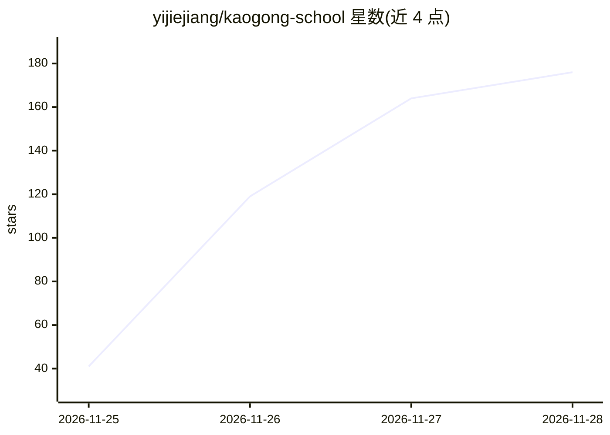

# yijiejiang/kaogong-school

⭐ 176 · Python · MIT · 推送 2026-11-27 · [GitHub](https://github.com/yijiejiang/kaogong-school) · 个人维护 · 中文 README

**考公备考者的本地多智能体 AI 学习系统：解析资料、出卷改卷**

面向公务员考试备考者的本地优先多智能体学习系统：上传 PDF/网页/音频/视频等资料后自动解析入库并打细粒度标签建题库，内置两百多项技能的技能地图，支持按标签组卷、限时答题、AI 改卷与逐题错因讲解，并基于真实作答更新学情看板与周计划。前端 Next.js、后端 FastAPI，数据默认存本机 SQLite；通过 make install/start 从源码运行，也提供 SwiftUI iOS 客户端。已知无登录鉴权，仅适合单人本机使用。

## 筛选速览

| 维度 | 判定 | 备注 |
|---|---|---|
| AI 角色 | `ai-native` | 本体是模型或模型工具 |
| 许可风险 | `permissive` | MIT |
| 部署形态 | `library` | 以包/库形式分发 |
| 模型依赖 | locked-api |  |
| 硬件要求 | — | 无带数字的原话,不猜 |
| 安装摩擦 | `high` | 编译与系统依赖俱全 |
| 成熟度 | — | 结构信号不足 |

## 能力要点

- 多格式资料解析：PDF、网页、图片、音频、B 站/YouTube 视频，视频可本地 whisper 转写并生成带时间戳笔记
- 题库自动切题并按「牛吃草」等细粒度标签打标，出卷按标签选题
- 组卷、自动判分、模型改卷与逐题错因讲解、掌握度更新闭环
- 演示模式无需 API Key 即可完整走通流程

## 适用场景

- 把散落在 PDF、网课、公众号里的备考资料整合成可检索的知识库
- 按薄弱点标签自动出一套专项试卷并批改讲错因
- 用技能地图和学情看板安排每周复习计划

## 场景标签

`多智能体` `知识库管理` `文档解析` · 领域:Agent 开发

## 证据(README 行号)

> L3: 考公私塾 · 多智能体考公辅导系统
> L24: - 按模块生成试卷，限时做完自动判分，逐题讲错因，顺手更新掌握度
> L30: 对话只有一个入口。问什么由辅导员判断该谁接：找资料、整理知识、出卷、讲错题、看学情，各有对应老师。

## 星数曲线

2026-11-25 41 → 2026-11-28 176（+135）

---
*卡片 v1 · prompt 1.4 · 生成 2026-11-27 · 置信度 mid · 依据 README sha `70777d6f6263` · [字段定义](../../DATASET.md)*
