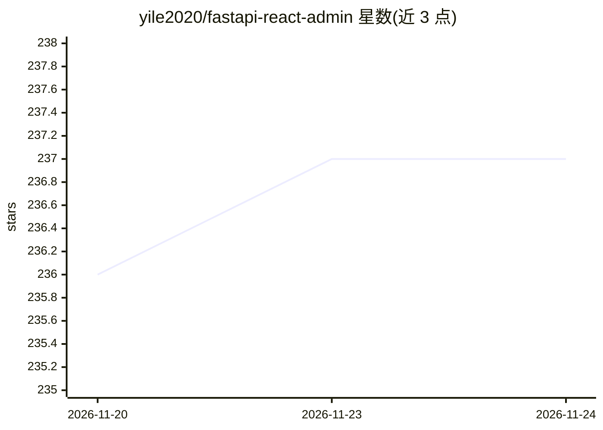

# yile2020/fastapi-react-admin

⭐ 237 · Python · MIT · 推送 2026-11-22 · [GitHub](https://github.com/yile2020/fastapi-react-admin) · [官网](https://fra.wubunan.com) · 个人维护 · 中文 README

**FastAPI+React 19 管理后台基座：RBAC/审批流/权限受限 AI 助手**

将登录、权限、组织架构、审批、文件、通知等系统开发重复部分固化为可复用基座。单仓 monorepo 包含 FastAPI+Celery 后端、React 19 Web 管理台、Electron 桌面模板与 Expo 移动模板。关键机制：模型列上的行级数据权限、React 19 `<Activity>` 保状态多标签、审批流设计器、权限绑定的 AI 助手（写入预览确认+审计+MCP 网关）、AK/SK 开放 API。需 Node ≥22.13、Python ≥3.11、uv 与 Docker，切换 SQL Server/MySQL 等见 CONTRIBUTING.md。

## 筛选速览

| 维度 | 判定 | 备注 |
|---|---|---|
| AI 角色 | `ai-enhanced` | 去掉 AI 部分产品仍成立 |
| 许可风险 | `permissive` | MIT |
| 部署形态 | `self-host` | docker 或自建部署 |
| 模型依赖 | — | README 未给出锁定关系 |
| 硬件要求 | — | 无带数字的原话,不猜 |
| 安装摩擦 | `low` | 无编译、无系统依赖或容器化 |
| 成熟度 | — | 结构信号不足 |

## 能力要点

- 行级数据权限：同表按部门数据范围控制可见行
- 权限受限 AI 助手：工具调用绑定用户权限与数据范围，写操作预览确认后执行并审计
- 支持 PostgreSQL/SQL Server/MySQL 三库同代码切换
- 1600+ 真实数据库与真实浏览器测试，CI 全量运行并公开 E2E 报告

## 适用场景

- 为新业务系统搭建带权限与审批的管理后台底座
- 重写多年运行的旧 Java+Vue 系统时复用基座
- 需要桌面端（静默打印/本地硬件/自动更新）的管理系统
- 需要通过开放 API 与 webhook 对外同步数据的企业系统

## 场景标签

`AI 助手` · 领域:对话与助手

## 证据(README 行号)

> L7: **A batteries-included admin foundation · FastAPI + React 19 + shadcn/ui**
> L9: Row-level permissions · multi-tab that keeps state · approval workflow · an AI assistant that can't overreach · S3 s
> L69: - **An AI assistant that can't overreach** — it can do exactly what the signed-in user can do; write actions are pr

## 星数曲线

2026-11-20 236 → 2026-11-24 237（+1）

---
*卡片 v1 · prompt 1.4 · 生成 2026-11-20 · 置信度 mid · 依据 README sha `dc5eb54c04c2` · [字段定义](../../DATASET.md)*
