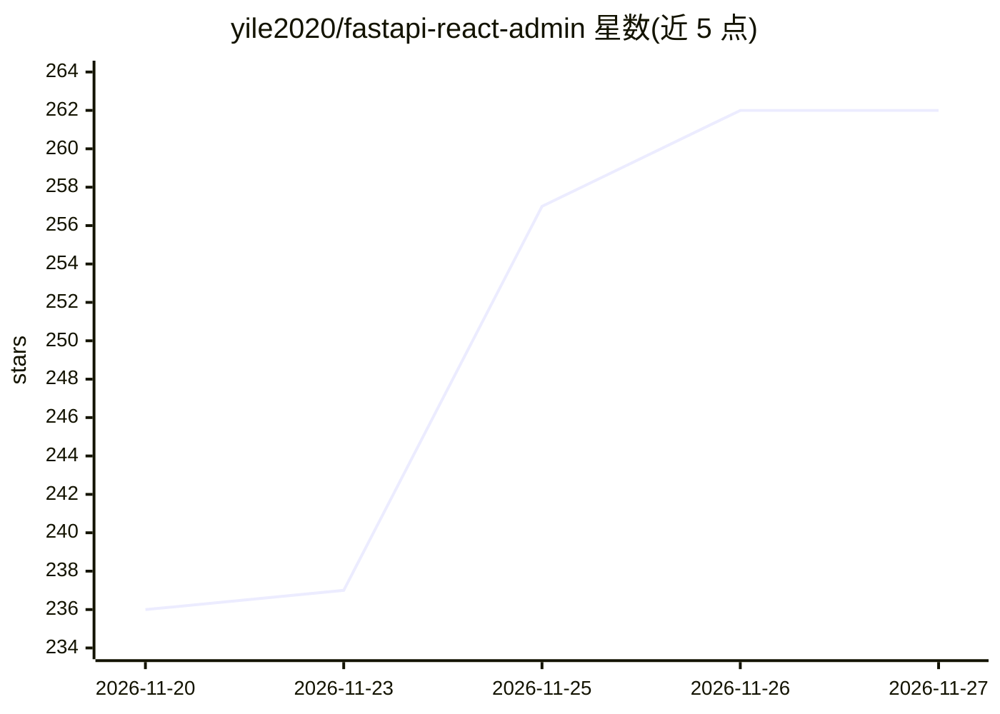

# yile2020/fastapi-react-admin

⭐ 262 · Python · MIT · 推送 2026-11-26 · [GitHub](https://github.com/yile2020/fastapi-react-admin) · [官网](https://fra.wubunan.com) · 个人维护 · 中文 README

**开发者可起步业务逻辑的 FastAPI+React 中后台基础工程**

从 Java+Vue 旧系统重写沉淀而来的中后台基础（admin foundation）：后端 FastAPI+Celery，前端 React 19+shadcn/ui，web、Electron 桌面与 Expo 移动端同仓（pnpm+turbo monorepo）。内置行级数据权限、RBAC、飞书式审批工作流、文件存储（本地/S3、秒传/断点续传）、Open API、消息通知与定时任务。面向 AI 编码场景：50+ 目录级 CLAUDE.md/AGENTS.md 规则文件、OpenAPI 生成的类型契约、1,600+ 无 mock 测试在 CI 运行。内置权限绑定的 AI 助手（pydantic-ai）并提供 MCP 网关。

## 筛选速览

| 维度 | 判定 | 备注 |
|---|---|---|
| AI 角色 | `ai-enhanced` | 去掉 AI 部分产品仍成立 |
| 许可风险 | `permissive` | MIT |
| 部署形态 | `self-host` | docker 或自建部署 |
| 模型依赖 | — | README 未给出锁定关系 |
| 硬件要求 | — | 无带数字的原话,不猜 |
| 安装摩擦 | `low` | 无编译、无系统依赖或容器化 |
| 成熟度 | — | 结构信号不足 |

## 能力要点

- 行级数据权限：同一张表按部门等数据范围控制可见行
- 审批工作流：表单设计器、或签/会签/退回/加签/超时处理，含 AI 预审与 AI 审批节点
- AI 助手按登录用户权限与数据范围约束写操作，预览确认+审计，另提供 MCP 网关
- 50+ 目录级 CLAUDE.md/AGENTS.md 规则文件配合 AI 编码

## 适用场景

- 为新的内部管理系统跳过登录/权限/审批等基建直接写业务逻辑
- 搭建需要行级数据权限的中后台
- 在 AI 辅助编码流程中使用带规则文件与类型契约的仓库

## 场景标签

`AI 助手` · 领域:对话与助手

## 证据(README 行号)

> L9: Row-level permissions · multi-tab that keeps state · approval workflow · an AI assistant that can't overreach · S3 s
> L71: - **An AI assistant that can't overreach** — it can do exactly what the signed-in user can do; write actions are pr
> L100: |**AI assistant**|full-page chat + side drawer · tool calls bound by permissions and data scopes · preview + confi

## 星数曲线

2026-11-20 236 → 2026-11-27 262（+26）

---
*卡片 v1 · prompt 1.4 · 生成 2026-11-27 · 置信度 mid · 依据 README sha `eb4720232f6b` · [字段定义](../../DATASET.md)*
