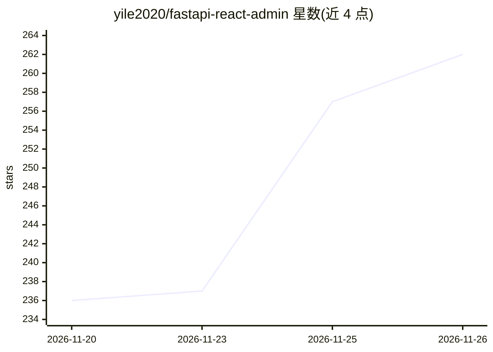

# yile2020/fastapi-react-admin

⭐ 262 · Python · MIT · 推送 2026-11-25 · [GitHub](https://github.com/yile2020/fastapi-react-admin) · [官网](https://fra.wubunan.com) · 组织维护 · 中文 README

**FastAPI+React 19 管理后台基座：内置权限、审批与受控 AI 助手**

以 monorepo 形式提供的管理后台基座，包含 FastAPI+Celery 后端、React 19 管理台、Electron 桌面模板与 Expo 移动模板。功能覆盖 RBAC 与行级数据权限、多标签页状态保持、类飞书审批流设计器、权限约束的 AI 助手（pydantic-ai，写入需确认并审计，工具经 MCP 网关暴露）、AK/SK 开放 API、S3 断点续传。依赖 Node ≥22.13、Python ≥3.11、uv 与 Docker，支持 PostgreSQL/SQL Server/MySQL 三种数据库切换。

## 筛选速览

| 维度 | 判定 | 备注 |
|---|---|---|
| AI 角色 | `ai-enhanced` | 去掉 AI 部分产品仍成立 |
| 许可风险 | `permissive` | MIT |
| 部署形态 | `self-host` | docker 或自建部署 |
| 模型依赖 | — | README 未给出锁定关系 |
| 硬件要求 | — | 无带数字的原话,不猜 |
| 安装摩擦 | `low` | 无编译、无系统依赖或容器化 |
| 成熟度 | — | 结构信号不足 |

## 能力要点

- 行级数据权限：同一张表按部门限定可见行
- AI 助手权限与数据范围绑定登录用户，写操作先预览确认并留审计日志
- 基于 React 19 <Activity> 的多标签页，切换不丢状态
- 1,600+ 测试对真实数据库与浏览器运行，无 mock

## 适用场景

- 新业务系统直接在权限、审批、文件等基座上写业务逻辑
- 替换长期运行的 Java+Vue 老旧管理后台
- 需要桌面端（静默打印/自动更新）与移动端审批的管理系统

## 场景标签

`AI 助手` · 领域:对话与助手

## 证据(README 行号)

> L7: **A batteries-included admin foundation · FastAPI + React 19 + shadcn/ui**
> L62: - **A backend inside the AI ecosystem** — Python + FastAPI, with the built-in AI assistant on pydantic-ai
> L98: |**AI assistant**|full-page chat + side drawer · tool calls bound by permissions and data scopes · preview + confir

## 星数曲线

2026-11-20 236 → 2026-11-26 262（+26）

---
*卡片 v1 · prompt 1.4 · 生成 2026-11-25 · 置信度 mid · 依据 README sha `8576dd8fb814` · [字段定义](../../DATASET.md)*
