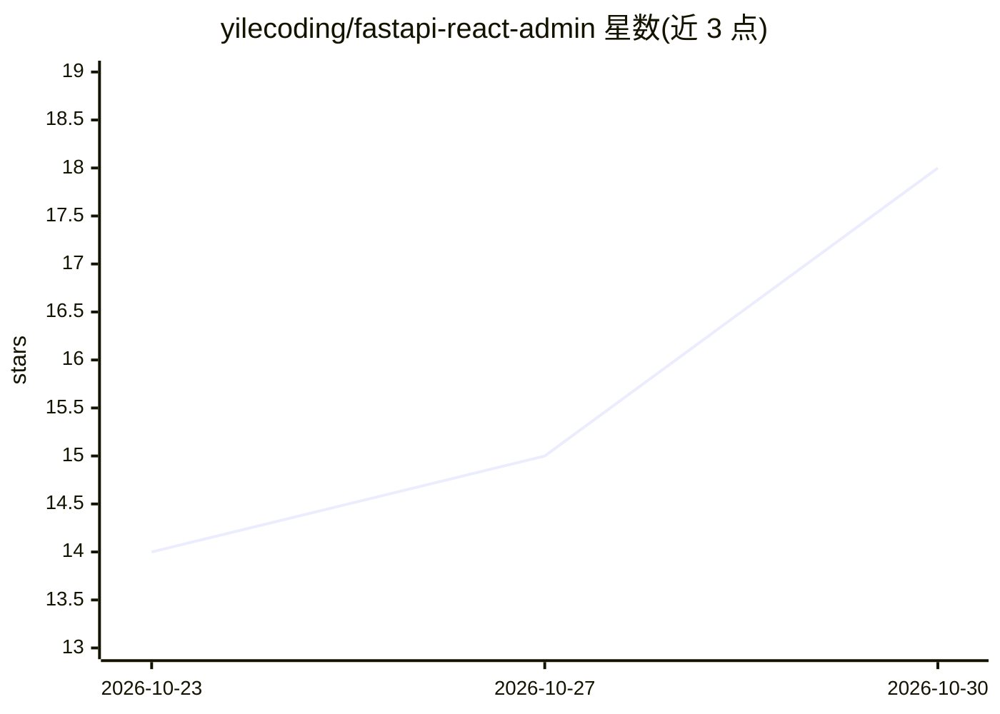

# yilecoding/fastapi-react-admin

⭐ 18 · Python · MIT · 推送 2026-10-29 · [GitHub](https://github.com/yilecoding/fastapi-react-admin) · [官网](https://fra.wubunan.com) · 个人维护 · 中文 README

**FastAPI + React 19 中后台底座：细粒度权限、审批流与受控 AI 助手**

开箱即用的中后台管理模板，前后端单仓：FastAPI + SQLAlchemy 2 后端，React 19 + shadcn/ui 前端。权限体系覆盖菜单、按钮与行级数据范围；基于 React 19 Activity 实现多页签保状态；内置飞书式审批流（表单设计器 + 流程树）、S3/本地文件存储与断点续传、开放接口与多端（Electron/Expo）。AI 助手受当前用户权限与数据范围约束，写操作需预演确认并留审计，另提供 MCP 网关；数据库支持 PostgreSQL/SQL Server/MySQL 三选一。

## 筛选速览

| 维度 | 判定 | 备注 |
|---|---|---|
| AI 角色 | `ai-enhanced` | 去掉 AI 部分产品仍成立 |
| 许可风险 | `permissive` | MIT |
| 部署形态 | `self-host` | docker 或自建部署 |
| 模型依赖 | — | README 未给出锁定关系 |
| 硬件要求 | — | 无带数字的原话,不猜 |
| 安装摩擦 | `low` | 无编译、无系统依赖或容器化 |
| 成熟度 | — | 结构信号不足 |

## 能力要点

- RBAC 细到按钮与行级数据范围
- 多页签基于 React 19 Activity 保状态，视图状态写入 URL
- 飞书式审批流：表单设计器 + 流程树，或签/会签/退回/加签
- AI 助手权限受当前登录人约束，写操作预演确认、调用留审计，含 MCP 网关

## 适用场景

- 搭建需要细粒度权限控制的企业中后台系统
- 快速获得带审批流、导入导出、文件管理的管理端底座
- 在管理系统中接入不越权的 AI 助手并对外提供开放接口

## 场景标签

`AI 助手` · 领域:对话与助手

## 证据(README 行号)

> L34: - **AI 助手不会越权** —— 它能做的事 = 当前登录的人能做的事；写操作先预演、本人确认才执行，全程留审计。
> L62: |**AI 助手**|整页对话 + 侧滑抽屉 · 受权限与数据范围约束的工具调用 · 写操作预演 + 确认 · 调用审计 · MCP 网关|

## 星数曲线

2026-10-23 14 → 2026-10-30 18（+4）

---
*卡片 v1 · prompt 1.4 · 生成 2026-10-30 · 置信度 high · 依据 README sha `2b9bc507b6ff` · [字段定义](../../DATASET.md)*
