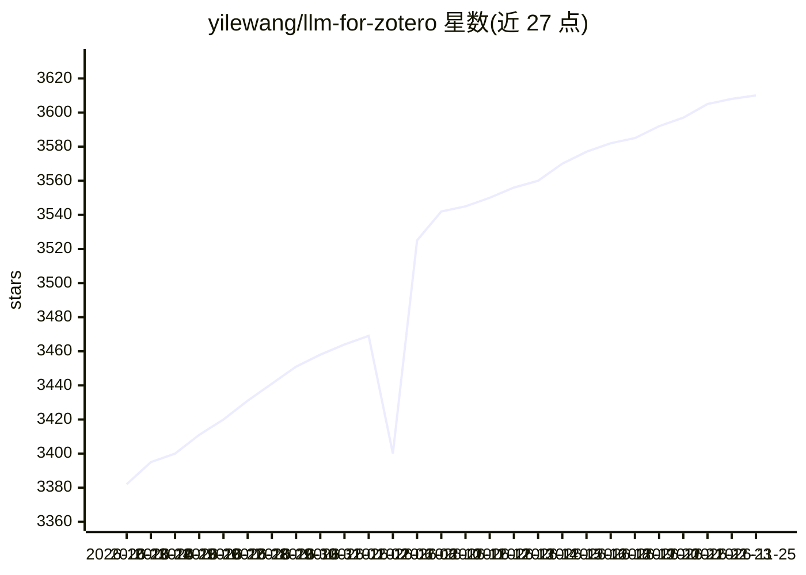

# yilewang/llm-for-zotero

⭐ 3,610 · TypeScript · AGPL-3.0 · 推送 2026-11-19 · [GitHub](https://github.com/yilewang/llm-for-zotero) · [官网](https://yilewang.github.io/llm-for-zotero) · 个人维护 · 中文 README

**把 LLM 助手与文献 Agent 嵌入 Zotero 阅读器的插件**

以 Zotero 插件（.xpi）形式安装，在 Zotero PDF 阅读器侧边栏提供论文问答、摘要、选中解释、图表截图解读与多论文对比，引用可点击跳回原文段落。Agent Mode（默认关闭）提供库内搜索、元数据/标签写入、批量笔记、文献发现等工具，写入操作需确认且可撤销。后端可选 API 提供商、本地 OpenAI 兼容模型、WebChat、Codex App Server 与 Claude Code；笔记可导出为 Markdown 到 Obsidian/Logseq 目录。

## 筛选速览

| 维度 | 判定 | 备注 |
|---|---|---|
| AI 角色 | `ai-native` | 本体是模型或模型工具 |
| 许可风险 | `viral` | AGPL-3.0 |
| 部署形态 | `desktop` | 安装包/桌面程序 |
| 模型依赖 | locked-api |  |
| 硬件要求 | — | 无带数字的原话,不猜 |
| 安装摩擦 | `low` | 无编译、无系统依赖或容器化 |
| 成熟度 | — | 结构信号不足 |

## 能力要点

- 带来源引用的论文问答，点击引用跳回 PDF 原文段落
- Agent Mode 提供库读写、文献发现、批量笔记等 30+ 工具，写入可确认与撤销
- 支持多种协议后端：responses_api/openai_chat_compat/anthropic_messages/gemini_native，含本地模型
- Markdown 笔记写入 Obsidian/Logseq 目录，使用 Pandoc 引用语法

## 适用场景

- 在 Zotero 里直接向 PDF 提问并生成带引用的回答
- 让 Agent 批量整理库内条目的标签、元数据与笔记
- 跨多篇论文做对比综述并导出到 Obsidian
- 通过 OpenAlex/arXiv/Europe PMC 查找相关论文并导入库中

## 场景标签

`科研工具` `文档问答` · 领域:知识与检索

## 证据(README 行号)

> L13: **LLM-for-Zotero** brings Large Language Models into the Zotero reader, so
> L96: On the first message, the model loads the current paper as context. Follow-up
> L211: ## Agent Mode (beta)

## 星数曲线

2026-10-23 3,382 → 2026-11-25 3,610（+228）

---
*卡片 v1 · prompt 1.4 · 生成 2026-11-23 · 置信度 mid · 依据 README sha `2970385db9ec` · [字段定义](../../DATASET.md)*
