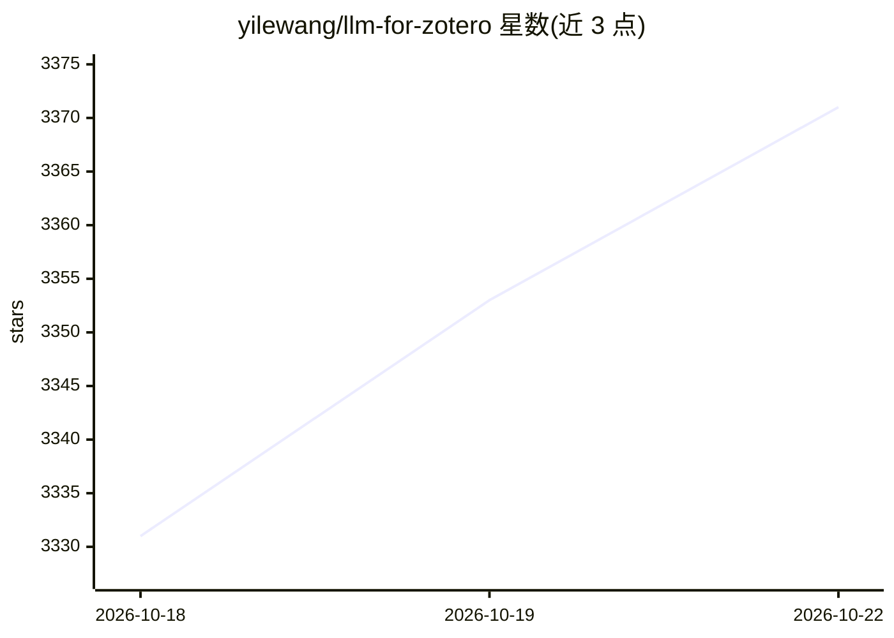

# yilewang/llm-for-zotero

⭐ 3,371 · TypeScript · AGPL-3.0 · 推送 2026-10-18 · [GitHub](https://github.com/yilewang/llm-for-zotero) · [官网](https://yilewang.github.io/llm-for-zotero) · 个人维护 · 中文 README

**Zotero 文献库的 LLM 研究助手插件，可问答、综述、管理文献**

以 .xpi 插件形式装入 Zotero 的研究 agent 系统：在 PDF 阅读器内对当前论文问答、总结、看图、跨文献对比，回答附可跳转原文的引用；可保存笔记到 Zotero 或 Obsidian/Logseq 等本地 Markdown 目录。Agent Mode（beta，默认关闭）提供约 10 类工具做文献库检索、元数据/标签写入（带确认与撤销）、OpenAlex/arXiv 等学术发现和 Tavily 网络搜索；后端支持标准 API、本地 OpenAI 兼容模型、WebChat、Codex App-Server 与 Claude Code。

## 筛选速览

| 维度 | 判定 | 备注 |
|---|---|---|
| AI 角色 | `ai-native` | 本体是模型或模型工具 |
| 许可风险 | `viral` | AGPL-3.0 |
| 部署形态 | `desktop` | 安装包/桌面程序 |
| 模型依赖 | — | README 未给出锁定关系 |
| 硬件要求 | — | 无带数字的原话,不猜 |
| 安装摩擦 | `low` | 无编译、无系统依赖或容器化 |
| 成熟度 | `idea` | |

## 能力要点

- 回答附引用并可跳转 Zotero 原文位置
- Agent Mode 提供文献库读写工具（写入需确认、可撤销）
- 支持 OpenAlex/arXiv/Europe PMC 学术检索与 Tavily 网络搜索
- 笔记可写入 Zotero 或 Obsidian/Logseq 等 Markdown 目录

## 适用场景

- 读论文时直接在 Zotero 里问答与总结，引用跳回原文
- 让 agent 批量给文献打标签、写笔记、找相关论文
- 把论文笔记自动落到 Obsidian 知识库

## 场景标签

`科研工具` `文档问答` · 领域:知识与检索

## 证据(README 行号)

> L13: **llm-for-zotero** brings Large Language Models into the Zotero reader, so
> L17: and Claude Code.
> L40: - Chat with the current PDF, selected text, figures, screenshots, and uploaded

## 星数曲线

2026-10-18 3,331 → 2026-10-22 3,371（+40）

---
*卡片 v1 · prompt 1.4 · 生成 2026-10-20 · 置信度 mid · 依据 README sha `167032dc0482` · [字段定义](../../DATASET.md)*
