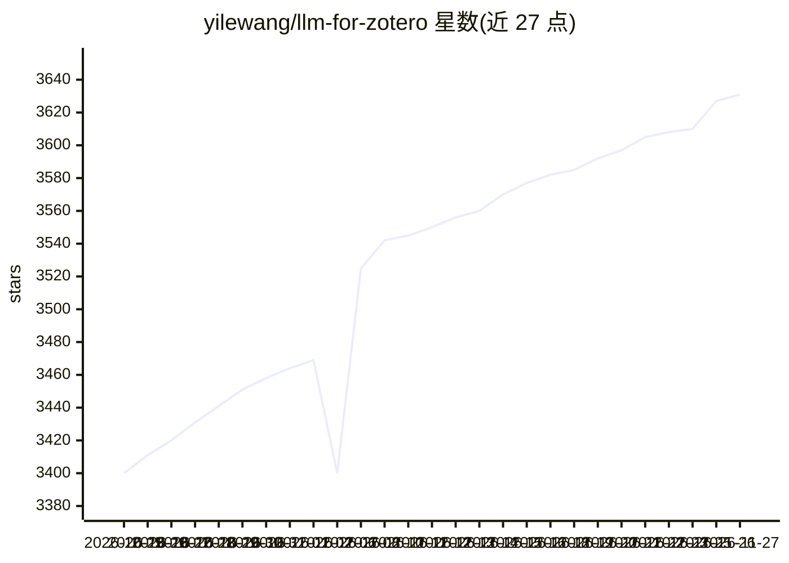

# yilewang/llm-for-zotero

⭐ 3,631 · TypeScript · AGPL-3.0 · 推送 2026-11-25 · [GitHub](https://github.com/yilewang/llm-for-zotero) · [官网](https://yilewang.github.io/llm-for-zotero) · 个人维护 · 中文 README

**面向 Zotero 用户的库内文献问答与研究代理插件**

以 Zotero 插件（.xpi）形式将 LLM 接入 Zotero 阅读器：在侧栏对当前 PDF、选中文本、图表与上传文档提问与摘要，生成的引用可点击跳回原文段落；支持多论文对比、笔记保存到 Zotero 或本地 Markdown 目录（Obsidian/Logseq）。Agent Mode（默认关闭）提供库级读/写/检索/导入/标注等约 30 个工具，读操作不受限、写操作需确认且可撤销。支持 responses_api、openai_chat_compat、anthropic_messages、gemini_native 四种协议及 WebChat、Codex App-Server、Claude Code 后端。

## 筛选速览

| 维度 | 判定 | 备注 |
|---|---|---|
| AI 角色 | `ai-native` | 本体是模型或模型工具 |
| 许可风险 | `viral` | AGPL-3.0 |
| 部署形态 | `desktop` | 安装包/桌面程序 |
| 模型依赖 | — | README 未给出锁定关系 |
| 硬件要求 | — | 无带数字的原话,不猜 |
| 安装摩擦 | `low` | 无编译、无系统依赖或容器化 |
| 成熟度 | — | 结构信号不足 |

## 能力要点

- 带出处的论文问答：引用点击跳转原文段落
- Agent Mode 提供库读写、文献检索（OpenAlex/arXiv/Europe PMC）与网页搜索工具，写操作需确认并支持撤销
- 笔记可写入 Zotero 内部或本地 Markdown 目录，使用 Pandoc 引用语法并保留 PDF 高亮
- 多后端：API key、本地 OpenAI 兼容模型、WebChat、Codex App-Server、Claude Code

## 适用场景

- 在 Zotero 内直接向论文提问并摘要
- 让代理在文献库中检索、打标签、整理元数据
- 把论文笔记自动写入 Obsidian/Logseq 库
- 多篇论文横向对比阅读

## 场景标签

`科研工具` `文档问答` · 领域:知识与检索

## 证据(README 行号)

> L13: **LLM-for-Zotero** brings Large Language Models into the Zotero reader, so
> L47: - Enable Agent Mode for library-wide read, search, tagging, metadata, import,
> L219: When enabled, the LLM can act on your Zotero library with read tools, write

## 星数曲线

2026-10-25 3,400 → 2026-11-27 3,631（+231）

---
*卡片 v1 · prompt 1.4 · 生成 2026-11-27 · 置信度 mid · 依据 README sha `46e335519634` · [字段定义](../../DATASET.md)*
