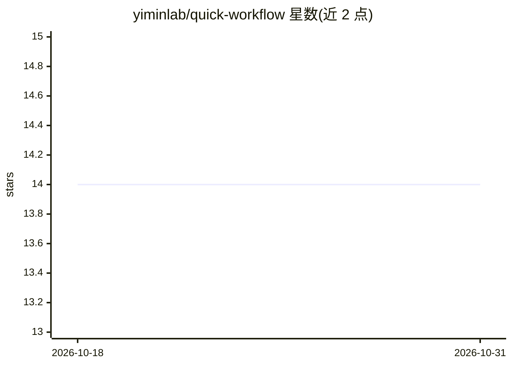

# yiminlab/quick-workflow

⭐ 14 · Go · MIT · 推送 2026-10-06 · [GitHub](https://github.com/yiminlab/quick-workflow) · 个人维护

**Go 编写的 GitHub PR 与 Jira 工作流自动化 CLI**

面向日常使用 GitHub PR 与 Jira 的开发者的命令行工具（qkflow）：一条命令完成建分支、提交、推送、创建 PR、回填 Jira 链接并更新状态；另一条命令完成合并 PR、删除分支与同步 Jira 状态。支持交互式提示、iCloud 配置同步（仅 macOS）、自动更新。AI 为可选功能：配置 OpenAI 或 DeepSeek API key 后可用 AI 生成 PR 标题与描述。提供二进制下载与源码构建两种安装方式。

## 筛选速览

| 维度 | 判定 | 备注 |
|---|---|---|
| AI 角色 | `ai-enhanced` | 去掉 AI 部分产品仍成立 |
| 许可风险 | `permissive` | MIT |
| 部署形态 | `None` |  |
| 模型依赖 | — | README 未给出锁定关系 |
| 硬件要求 | — | 无带数字的原话,不猜 |
| 安装摩擦 | `medium` | 含编译或系统依赖之一 |
| 成熟度 | — | 结构信号不足 |

## 能力要点

- 一条命令完成建分支/提交/推送/创建 PR/更新 Jira 全流程
- 合并 PR 后自动删除远端与本地分支并更新 Jira 状态
- 可选配置 OpenAI/DeepSeek API key 用 AI 生成 PR 标题与描述
- macOS 下配置自动同步至 iCloud Drive

## 适用场景

- 我每天要建多个 PR 并手动更新 Jira 状态，想用一条命令完成
- 合并 PR 后希望自动清理分支并同步 Jira 状态
- 不想手写 PR 标题和描述，让 AI 代为生成

## 场景标签

`工作流自动化` · 领域:效率与自动化

## 证据(README 行号)

> L5: A modern CLI tool to automate your daily GitHub PR and Jira workflow, written in Go.
> L77: - Optional: OpenAI API key for AI features
> L106: 2. ✅ Prompts for PR title and description (or uses AI to generate)

## 星数曲线

2026-10-18 14 → 2026-10-31 14（+0）

---
*卡片 v1 · prompt 1.4 · 生成 2026-10-31 · 置信度 high · 依据 README sha `6be941f08a43` · [字段定义](../../DATASET.md)*
