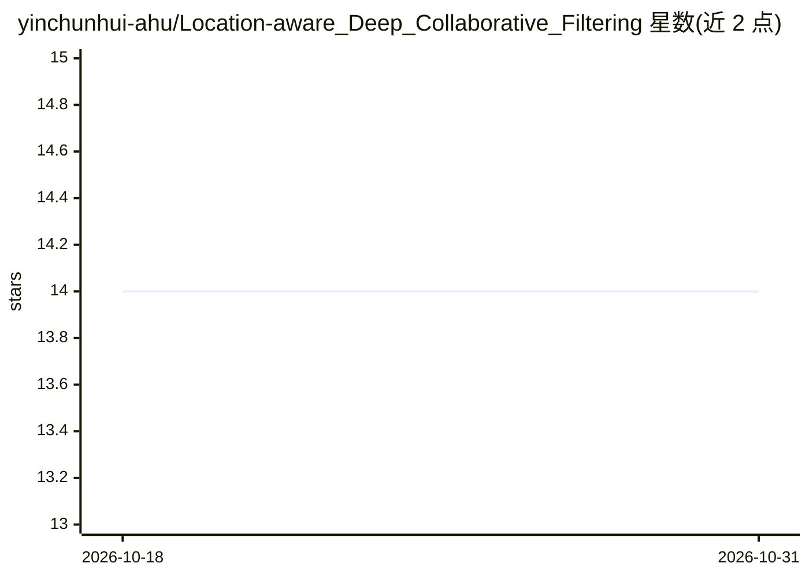

# yinchunhui-ahu/Location-aware_Deep_Collaborative_Filtering

⭐ 14 · Python · MIT · 推送 2026-06-02 · [GitHub](https://github.com/yinchunhui-ahu/Location-aware_Deep_Collaborative_Filtering) · [官网](http://bigdata.ahu.edu.cn) · 个人维护 · 中文 README

**论文 LDCF 的 PyTorch 复现：位置感知协同过滤预测服务 QoS**

论文 Location-aware Deep Collaborative Filtering for Service Recommendation 的复现代码，从原 Keras 2 / TensorFlow 1.4 迁移到 PyTorch。模型在用户-服务稀疏矩阵上预测 Web 服务的响应时间或吞吐量，将 ID 嵌入与国家/AS 位置嵌入拼接输入 MLP，并用位置隐向量余弦相似度分支（AC-COS）辅助回归，损失为 Huber Loss。提供数据预处理脚本（WS-Dream Dataset#1）、pytest 单元测试、随机种子与 cudnn 确定性设置，并以统计意义对齐原版 MAE/RMSE 指标为复现目标。原始 Keras 实现归档在 legacy/ 目录。

## 筛选速览

| 维度 | 判定 | 备注 |
|---|---|---|
| AI 角色 | `ai-native` | 本体是模型或模型工具 |
| 许可风险 | `permissive` | MIT |
| 部署形态 | `library` | 以包/库形式分发 |
| 模型依赖 | — | README 未给出锁定关系 |
| 硬件要求 | — | 无带数字的原话,不猜 |
| 安装摩擦 | `low` | 无编译、无系统依赖或容器化 |
| 成熟度 | — | 结构信号不足 |

## 能力要点

- 用户/服务 ID 嵌入 ⊕ 位置嵌入（国家/AS）拼接的 MLP 结构
- AC-COS 分支：位置隐向量余弦相似度参与 QoS 回归
- 提供 WS-Dream 数据预处理脚本与 pytest 合成数据单元测试
- 支持 --seed 与 cudnn deterministic 的可复现性设置

## 适用场景

- 复现论文在 WS-Dream 数据集上的 QoS 预测指标
- 研究位置感知（地理-网络）特征对服务推荐的影响
- 作为协同过滤 QoS 预测的 PyTorch 代码基础进行改写实验

## 场景标签

`推荐系统` · 领域:学习与行业

## 证据(README 行号)

> L3: 本仓库是论文 **Location-aware Deep Collaborative Filtering for Service Recommendation** 的复现代码，已从原 Keras 2 / TensorFlow 1.4
> L13: 在 Web 服务 QoS（服务质量）场景下，对用户-服务的稀疏观测矩阵预测**响应时间 (rt)** 或**吞吐量 (tp)**。模型在协同过滤基础上引入**位置感知**（用户/服务的国家、AS 等地理-网络位置特征）。

## 星数曲线

2026-10-18 14 → 2026-10-31 14（+0）

---
*卡片 v1 · prompt 1.4 · 生成 2026-10-31 · 置信度 mid · 依据 README sha `15484c973e5a` · [字段定义](../../DATASET.md)*
