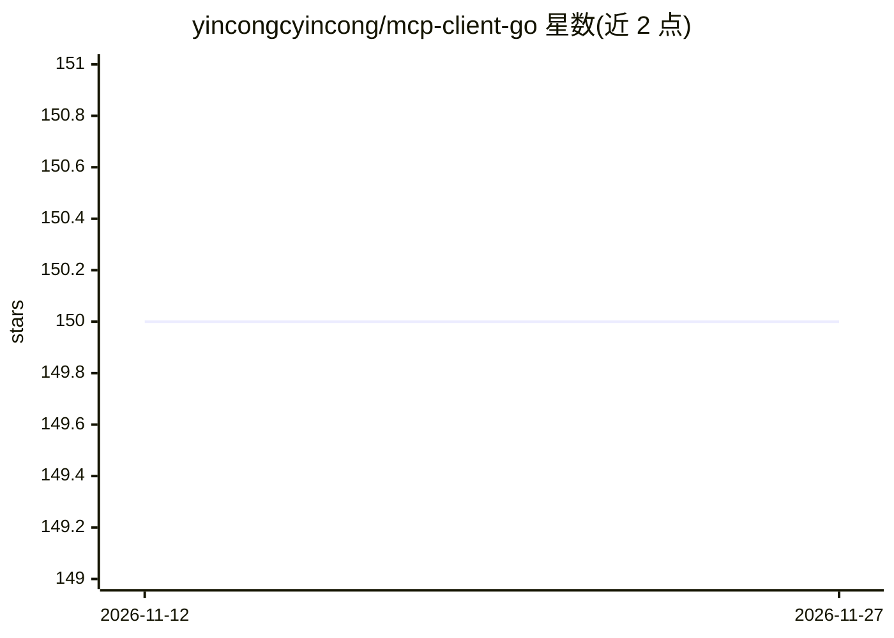

# yincongcyincong/mcp-client-go

⭐ 150 · Go · MIT · 推送 2026-11-12 · [GitHub](https://github.com/yincongcyincong/mcp-client-go) · 个人维护 · 中文 README

**Go 语言的 MCP 客户端库：统一注册并调用多个 MCP 服务**

Golang 编写的 Model Context Protocol (MCP) 客户端库：开发者以统一 API 注册并管理多个 MCP server（覆盖高德地图、GitHub、PostgreSQL、Playwright 等 50 余个服务），按工具名或客户端名获取实例并执行工具调用；支持 Claude 风格的配置文件与通过 prompt 触发 MCP，提供 stdio 与 Streamable HTTP 传输。附带 client、deepseek、openai 等 demo 与 guarded-filesystem 安全代理示例。MIT 许可。

## 筛选速览

| 维度 | 判定 | 备注 |
|---|---|---|
| AI 角色 | `ai-ecosystem` | LLM/agent 周边工具 |
| 许可风险 | `permissive` | MIT |
| 部署形态 | `None` |  |
| 模型依赖 | — | README 未给出锁定关系 |
| 硬件要求 | — | 无带数字的原话,不猜 |
| 安装摩擦 | `low` | 无编译、无系统依赖或容器化 |
| 成熟度 | — | 结构信号不足 |

## 能力要点

- 统一注册与客户端管理接口，支持按客户端名或工具名获取实例
- 声明支持 50 余个 MCP server（Amap、GitHub、Playwright、Parallel 等）
- 支持 Claude 风格配置文件与 prompt 触发 MCP
- 提供经 Armorer Guard 检查提示注入/凭据泄露的本地 stdio 代理示例

## 适用场景

- 在 Go 应用中接入多个 MCP server 并统一调用其工具
- 用自然语言 prompt 触发 MCP 工具执行
- 为 LLM 应用构建带安全检查的 MCP 调用链路

## 场景标签

 · 领域:LLM 基础设施/MCP 客户端

## 证据(README 行号)

> L3: `mcp-client-go` is a Golang client library for the **Model Context Protocol (MCP)**. It allows developers to registe
> L127: clients.RegisterMCPClient(context.Background(), []*param.MCPClientConf{conf})
> L141: client.ExecTools(ctx, "tool_name", map[string]interface{}{...})

## 星数曲线

2026-11-12 150 → 2026-11-27 150（+0）

---
*卡片 v1 · prompt 1.4 · 生成 2026-11-17 · 置信度 high · 依据 README sha `9d881c86f00d` · [字段定义](../../DATASET.md)*
