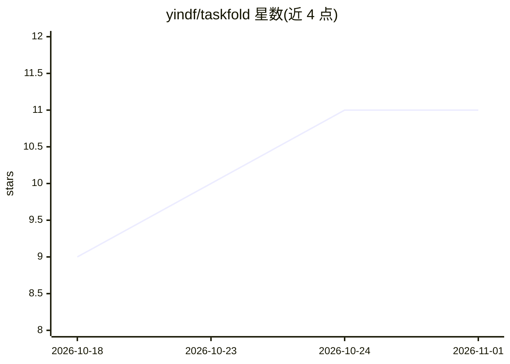

# yindf/taskfold

⭐ 11 · JavaScript · MIT · 推送 2026-10-30 · [GitHub](https://github.com/yindf/taskfold) · [官网](https://www.npmjs.com/package/dsh-taskfold) · 个人维护 · 中文 README

**DeepSeek Harness 插件：将已完成的任务段折叠为摘要，按需召回原文**

面向 DeepSeek Harness（DSH）的上下文管理插件：agent 用 task_begin/task_end 包裹任务，结束时把整段往返折叠为带标题的简短摘要，原文保存到文件并可用 fold_recall 按编号召回。提供 4 个 agent 工具（task_begin、task_end、list_folds、fold_recall），以及可配置的折叠下限 minSpanTokens（默认 2000，低于下限的段直接关闭不折叠）。README 报告一次实测会话：总 prompt token 下降 63.5%，峰值上下文占用从 59.5% 降至 20.7%。仅支持 dsh rc/alpha 版本对应分支，通过 dsh Desktop 插件页或命令行安装。

## 筛选速览

| 维度 | 判定 | 备注 |
|---|---|---|
| AI 角色 | `ai-ecosystem` | LLM/agent 周边工具 |
| 许可风险 | `permissive` | MIT |
| 部署形态 | `library` | 以包/库形式分发 |
| 模型依赖 | — | README 未给出锁定关系 |
| 硬件要求 | — | 无带数字的原话,不猜 |
| 安装摩擦 | `low` | 无编译、无系统依赖或容器化 |
| 成熟度 | — | 结构信号不足 |

## 能力要点

- task_end 关闭任务时将整段折叠为一条带标题摘要，原文存档
- fold_recall 可按编号召回任何折叠段的原始消息
- minSpanTokens 折叠下限（默认 2000），低于下限的段不进入归档队列
- README 给出实测数据：总 prompt token −63.5%，峰值上下文占用 59.5%→20.7%

## 适用场景

- 长编码会话中控制上下文窗口占用与 token 成本
- 把已完成任务的完整过程折叠成可读摘要，保持会话可导航
- 需要时召回某次任务的原始对话细节

## 场景标签

`Agent 记忆` · 领域:Agent 开发

## 证据(README 行号)

> L12:  DeepSeek Harness plugin
> L57: Restart dsh — every session on that profile gets the tools. The agent then wraps its work in named tasks:

## 星数曲线

2026-10-18 9 → 2026-11-01 11（+2）

---
*卡片 v1 · prompt 1.4 · 生成 2026-11-01 · 置信度 high · 依据 README sha `123fc012b9e1` · [字段定义](../../DATASET.md)*
