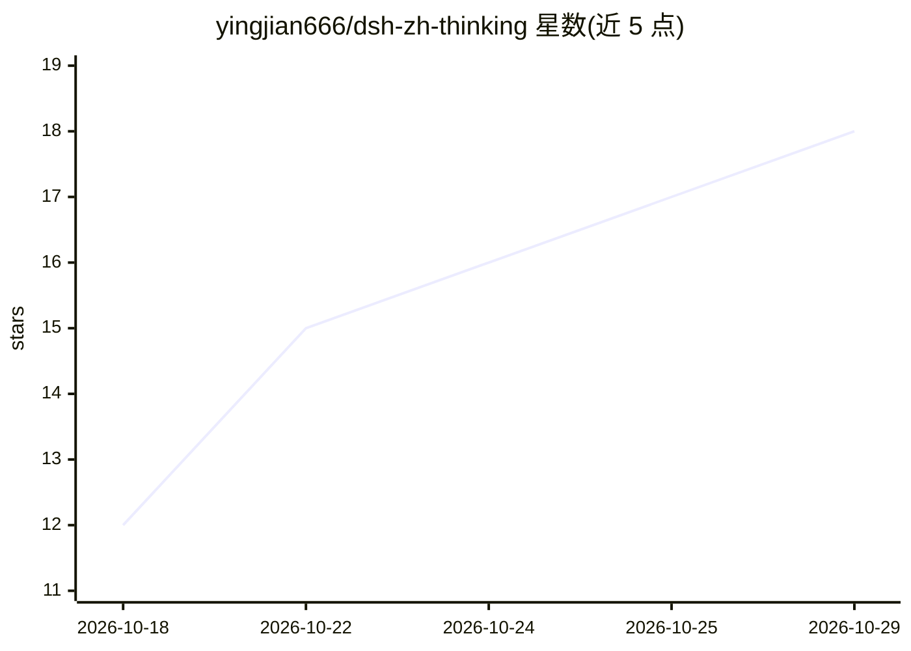

# yingjian666/dsh-zh-thinking

⭐ 18 · JavaScript · MIT · 推送 2026-10-01 · [GitHub](https://github.com/yingjian666/dsh-zh-thinking) · 个人维护 · 中文 README

**DeepSeek Harness 宿主插件：强制 Agent 思维链全程使用简体中文**

面向 DeepSeek Harness (DSH) 的宿主插件：启动时通过 ctx.systemPrompt.section() 在系统提示词 persona 段之后注入一段「必须用简体中文思考」的规则，作用于推理模型的思维链、规划、工具调用推理与自我审查，防止工具返回英文内容后思考语言漂移为英文；最终回答语言不强制。零外部依赖、零配置，单文件实现，插件卸载时自动移除注册段。提供 DSH Desktop GUI 安装（GitHub 来源/.tgz）与 CLI 两种途径，兼容内核 0.1.1-rc.1 至 0.2.0-rc.2。作者声明为个人学习性质尝试，不承诺持续维护。

## 筛选速览

| 维度 | 判定 | 备注 |
|---|---|---|
| AI 角色 | `ai-ecosystem` | LLM/agent 周边工具 |
| 许可风险 | `permissive` | MIT |
| 部署形态 | `desktop` | 安装包/桌面程序 |
| 模型依赖 | — | README 未给出锁定关系 |
| 硬件要求 | — | 无带数字的原话,不猜 |
| 安装摩擦 | `low` | 无编译、无系统依赖或容器化 |
| 成熟度 | `idea` | |

## 能力要点

- 向系统提示词注入中文思考规则，作用于链式推理/规划/工具调用推理
- 零外部依赖，仅使用 cordis 运行时注入的 ctx，任意本地目录挂载可加载
- 兼容 DSH 内核 0.1.1-rc.1 至 0.2.0-rc.2，含真实内核冒烟测试
- 插件卸载/上下文停止时自动回收注册的提示词段

## 适用场景

- DSH Agent 工具返回英文内容后思考切到英文，需要保持中文思维链
- 让 DeepSeek 推理模型的规划与工具推理过程稳定输出简体中文

## 场景标签

`提示工程` · 领域:Agent 开发

## 证据(README 行号)

> L12: 让 DeepSeek Harness 里 Agent 的**内部思考过程**——思维链（chain-of-thought）、逐步规划、工具调用前后的推理、自我审查——始终使用**简体中文**的宿主插件（host plugin）。
> L230: DSH 把每条请求的系统提示词由一个 `systemPrompt` 注册表拼装。本插件在启动时调用 `ctx.systemPrompt.section(...)`，往提示词里插入一段「必须用简体中文思考」的规则（放在 perso

## 星数曲线

2026-10-18 12 → 2026-10-29 18（+6）

---
*卡片 v1 · prompt 1.4 · 生成 2026-10-29 · 置信度 high · 依据 README sha `e9a30efba664` · [字段定义](../../DATASET.md)*
