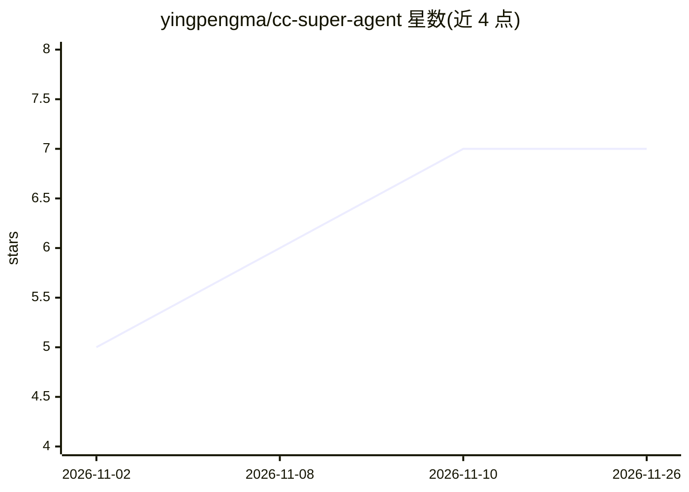

# yingpengma/cc-super-agent

⭐ 7 · JavaScript · MIT · 推送 2026-11-02 · [GitHub](https://github.com/yingpengma/cc-super-agent) · 个人维护 · 中文 README

**为 Claude Code 提供 Router–Worker 多代理编排的个人代理**

按 DeepSeek 公开的 Super-agent（Router–Worker 两层）设计实现的开源编排系统：用户只与一个 Router 会话对话，Router 为每个任务启动独立的 Claude Code Worker 会话，用三层 Markdown 文件记录任务与项目状态，并由 cron 驱动的独立 Watchdog 进程检测卡死、静默或漂移的 Worker。基于 Claude Code 现有 CLI 能力（claude -p、--resume 等）运行，不修改上游；提供终端与 Web UI 两种入口，需 Linux、bash 工具链、cron/tmux/systemd。状态标注为 experimental。

## 筛选速览

| 维度 | 判定 | 备注 |
|---|---|---|
| AI 角色 | `ai-ecosystem` | LLM/agent 周边工具 |
| 许可风险 | `permissive` | MIT |
| 部署形态 | `None` |  |
| 模型依赖 | — | README 未给出锁定关系 |
| 硬件要求 | — | 无带数字的原话,不猜 |
| 安装摩擦 | `low` | 无编译、无系统依赖或容器化 |
| 成熟度 | `idea` | |

## 能力要点

- 一个 Router 管理多个项目中的 Claude Code Worker 会话
- cron 驱动的 Watchdog 检测死亡、静默、循环与等待提示的 Worker
- 三层 Markdown wiki 记录任务与项目状态，Router 重启后可恢复
- Web UI 展示 Router 与 Worker 的全部消息，可驳回标记

## 适用场景

- 同时推进多个项目里的 Claude Code 会话，不必逐个切标签页
- 在服务器上让 Router 持续运行，合上电脑后任务继续
- 把反复手工纠正的偏好沉淀为可读的判断模型

## 场景标签

`多智能体` `编码 Agent` · 领域:Agent 开发

## 证据(README 行号)

> L5: Architecture: Router–Worker
> L12: cc-super-agent is an open-source implementation of the **Super-agent** design that DeepSeek published in October 20
> L29: - 🧭 **One Router, many Workers.** The Router never does the work itself, so it is always free to take your next mes

## 星数曲线

2026-11-02 5 → 2026-11-26 7（+2）

---
*卡片 v1 · prompt 1.4 · 生成 2026-11-20 · 置信度 high · 依据 README sha `7d95ec95505b` · [字段定义](../../DATASET.md)*
