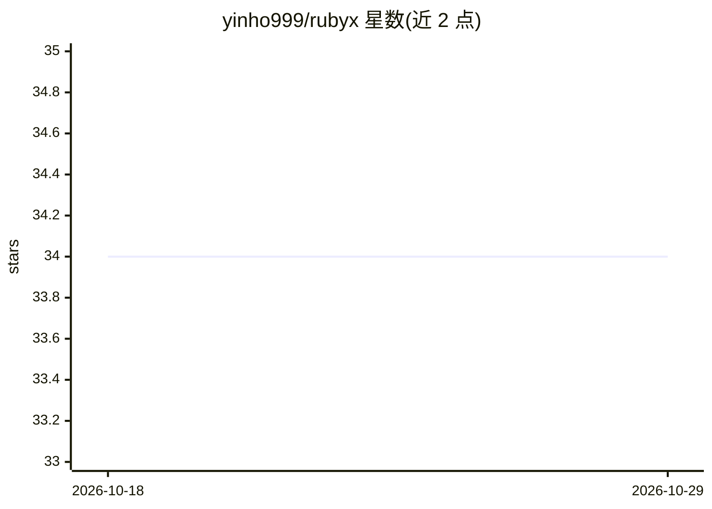

# yinho999/rubyx

⭐ 34 · Rust · 推送 2026-05-20 · [GitHub](https://github.com/yinho999/rubyx) · 个人维护

**Ruby 进程内直调 Python 的互操作库，基于 Rust**

Rubyx-py 是一个 Ruby gem，通过 Rust（magnus + rb-sys 架构）实现 Ruby 与 Python 的进程内互操作，无微服务或 REST 开销。提供 Rubyx.import 导入 Python 模块、eval 执行代码并传入 Ruby 数据、stream 迭代 Python 生成器、async_await 异步调用（等待期间释放 GVL）等 API；Python 异常映射为对应的 Ruby 异常类。Python >= 3.12 由 uv 自动管理，需 Ruby >= 3.0，从源码构建需 Rust；提供 Linux 与 macOS（x86_64/ARM64）预编译 gem，并含 Rails 生成器与 rake 任务。

## 筛选速览

| 维度 | 判定 | 备注 |
|---|---|---|
| AI 角色 | `ai-ecosystem` | LLM/agent 周边工具 |
| 许可风险 | `permissive` | — |
| 部署形态 | `None` |  |
| 模型依赖 | — | README 未给出锁定关系 |
| 硬件要求 | — | 无带数字的原话,不猜 |
| 安装摩擦 | `low` | 无编译、无系统依赖或容器化 |
| 成熟度 | — | 结构信号不足 |

## 能力要点

- 进程内直接互操作，提供 import/eval/stream/async_await 等 API
- 流式与异步调用期间释放 Ruby GVL，支持并发
- Python 异常映射为 Ruby 异常类（含 traceback）
- Rails 集成：安装生成器、pyproject.toml 依赖管理、rake 任务

## 适用场景

- 在 Rails 应用中调用 numpy/pandas/transformers 等 Python 库
- 在 Ruby 中实时流式消费 Python LLM token 输出
- 非阻塞执行 Python ML 推理与数据处理任务

## 场景标签

 · 领域:跨语言互操作/开发工具

## 证据(README 行号)

> L5: **Call Python from Ruby. No microservices, no REST APIs, no serialization overhead.**
> L48: Ideal for LLM streaming, ML inference, data pipelines, and high-concurrency Rails apps.

## 星数曲线

2026-10-18 34 → 2026-10-29 34（+0）

---
*卡片 v1 · prompt 1.4 · 生成 2026-10-25 · 置信度 mid · 依据 README sha `c82ef0f6af7f` · [字段定义](../../DATASET.md)*
