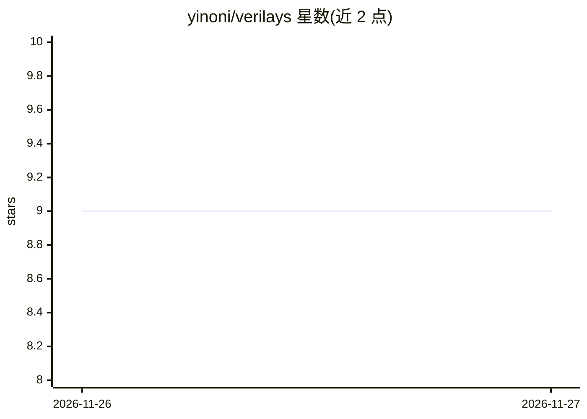

# yinoni/verilays

⭐ 9 · Python · Apache-2.0 · 推送 2026-11-26 · [GitHub](https://github.com/yinoni/verilays) · 个人维护

**核验 agent 声称的数据库写操作是否真实发生的工具**

针对 agent 工具调用自报成功但实际未落库的问题，Verilays 通过装饰器记录工具声称的写入内容，由后台 worker 周期性从用户自己的 Postgres 只读回读记录，输出 verified/mismatch/missing/ambiguous/failed 等八种判定状态。面向开发 agent 的工程师，支持只读连接、重复写入检测、自定义 verify 检查，并可将判定结果作为 score 写回 Langfuse 追踪。当前仅支持 Postgres 存储，且只能检查经过包装的工具调用。

## 筛选速览

| 维度 | 判定 | 备注 |
|---|---|---|
| AI 角色 | `ai-ecosystem` | LLM/agent 周边工具 |
| 许可风险 | `permissive` | Apache-2.0 |
| 部署形态 | `self-host` | docker 或自建部署 |
| 模型依赖 | — | README 未给出锁定关系 |
| 硬件要求 | — | 无带数字的原话,不猜 |
| 安装摩擦 | `low` | 无编译、无系统依赖或容器化 |
| 成熟度 | — | 结构信号不足 |

## 能力要点

- 装饰器包装工具后自动记录声称结果，worker 每 3-10 秒回读数据库核验
- 八种判定状态含 mismatch 值差异 diff 与 duplicate 检测
- worker 以只读连接访问目标数据库，记录失败不中断工具执行
- 可集成 Langfuse，判定结果作为 score 关联到工具调用

## 适用场景

- 检测 agent 预订/下单类工具调用是否真正写入数据库
- 排查工具返回成功但数据未落库或写错值的情况
- 在 Langfuse 追踪中查看每个工具调用的落库核验结果

## 场景标签

`LLM 可观测性` · 领域:评测与运维

## 证据(README 行号)

> L5: An agent's "done" is a self-report. Verilays is an open-source tool that checks your database to see if what the age
> L9: Your agent tells a customer "you're booked for Tuesday at 10:00". The tool returned success, the trace looks fine, a
> L43: **Let your coding agent do it.** Add the skill, then ask Claude Code, Cursor or Codex to add Verilays to your agent

## 星数曲线

2026-11-26 9 → 2026-11-27 9（+0）

---
*卡片 v1 · prompt 1.4 · 生成 2026-11-26 · 置信度 high · 依据 README sha `f368907a8a17` · [字段定义](../../DATASET.md)*
