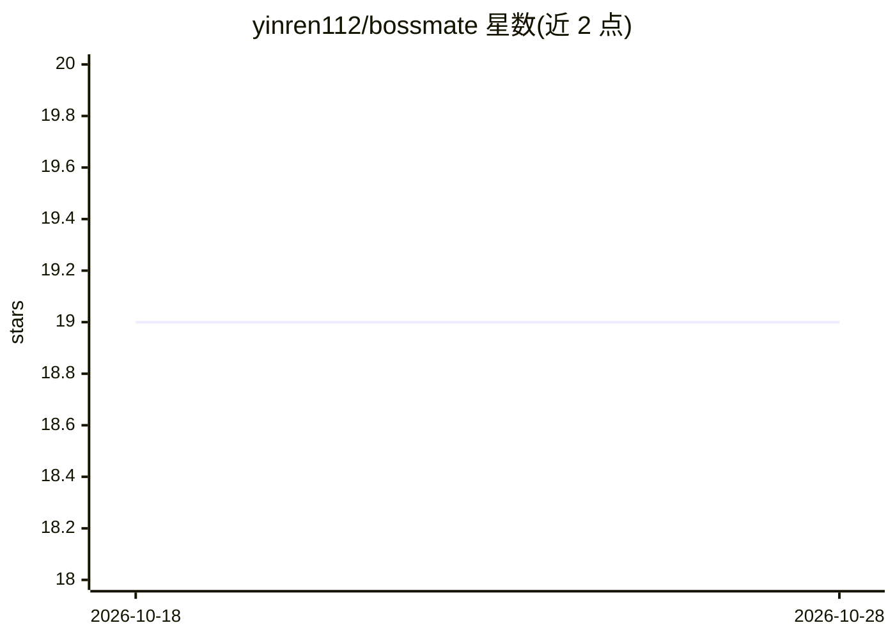

# yinren112/bossmate

⭐ 19 · JavaScript · MIT · 推送 2026-09-24 · [GitHub](https://github.com/yinren112/bossmate) · [官网](https://www.npmjs.com/package/bossmate) · 个人维护 · 中文 README

**装入 AI agent 的 BOSS 直聘求职技能：JD 筛选与定制化投递**

以 npm 包安装进 Codex、Claude Code、OpenCode、Hermes 或 WorkBuddy 的本地求职技能：AI agent 负责读取简历、判断 JD 匹配与撰写定制首条消息，随技能安装的本地脚本负责浏览器控制、台账、去重、发送门控与送达核验。通过原生 CDP 连接用户自行登录的专属浏览器窗口，简历与浏览器配置默认留在本机。发送前须通过多项安全门控；公开版尚不支持自动发送附件；浏览器启动脚本仅在 Windows 上人工验证过。

## 筛选速览

| 维度 | 判定 | 备注 |
|---|---|---|
| AI 角色 | `ai-ecosystem` | LLM/agent 周边工具 |
| 许可风险 | `permissive` | MIT |
| 部署形态 | `library` | 以包/库形式分发 |
| 模型依赖 | — | README 未给出锁定关系 |
| 硬件要求 | — | 无带数字的原话,不猜 |
| 安装摩擦 | `low` | 无编译、无系统依赖或容器化 |
| 成熟度 | — | 结构信号不足 |

## 能力要点

- 5 种 agent 一致的技能安装与核心工作流
- 基于 Chrome DevTools Protocol 的专属浏览器控制，无额外运行时依赖
- 8 项发送前安全门控与送达/已读核验
- node scripts/boss.js doctor 全离线诊断

## 适用场景

- 让日常使用的 AI agent 按我的硬性条件筛 JD 并代拟首条消息
- 去重追踪联系过的招聘者并核验消息送达
- 在本地保留简历与浏览器配置的前提下自动化 BOSS 直聘求职流程

## 场景标签

`浏览器自动化` · 领域:效率与自动化

## 证据(README 行号)

> L7: A local job-search **skill** you install into **Codex, Claude Code, OpenCode, Hermes, or WorkBuddy**.
> L109: The AI agent is responsible for understanding the resume, judging the job description, and writing
> L111: control, the ledger, dedup, send gates, and delivery verification. Judgment and execution are kept

## 星数曲线

2026-10-18 19 → 2026-10-28 19（+0）

---
*卡片 v1 · prompt 1.4 · 生成 2026-10-28 · 置信度 high · 依据 README sha `afd59caf2bab` · [字段定义](../../DATASET.md)*
