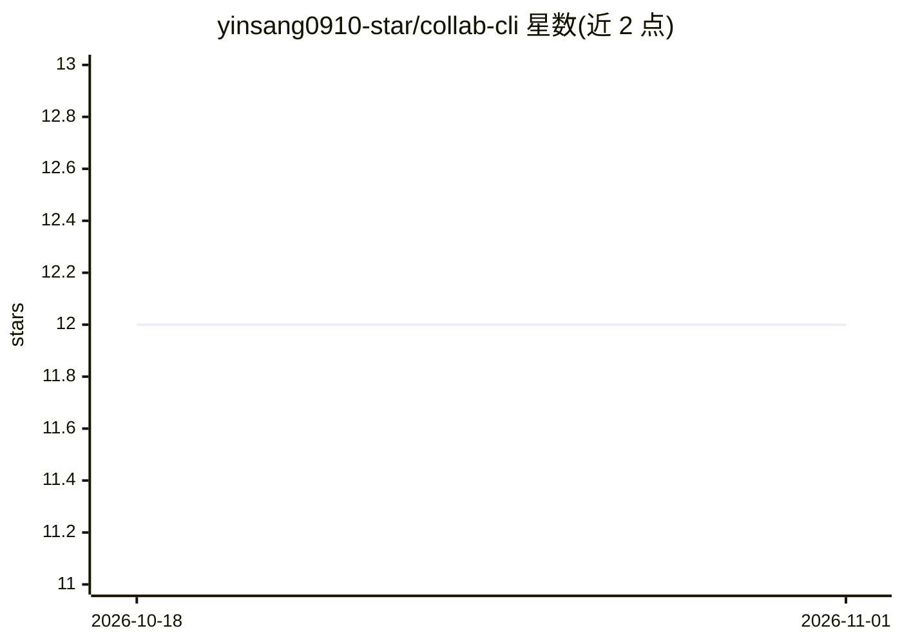

# yinsang0910-star/collab-cli

⭐ 12 · JavaScript · 推送 2026-06-14 · [GitHub](https://github.com/yinsang0910-star/collab-cli) · 个人维护 · 中文 README

**多 Agent 跨设备协作 CLI：共享内存、互发命令、自动审查**

面向运行多个 AI 编码代理（Claude Code、Reasonix、Codex、WorkBuddy、Cursor 等）的开发者的 npm 命令行工具。通过 UDP 局域网自动发现与 HTTP 每 10 秒同步，让不同机器上的代理共享分级记忆（80 行 SHARD.md、memory/、archive/）、直接互发命令（P0 需用户确认）、提交前自审。提供基于徽章的 5 级权限、任务生命周期、收件箱消息、心跳监控、MCP Server（17 个工具）、Web 仪表盘与 Git 集成。集成方式仅为文件复制，无 SDK 依赖。MIT 许可。

## 筛选速览

| 维度 | 判定 | 备注 |
|---|---|---|
| AI 角色 | `ai-ecosystem` | LLM/agent 周边工具 |
| 许可风险 | `none` | — |
| 部署形态 | `library` | 以包/库形式分发 |
| 模型依赖 | — | README 未给出锁定关系 |
| 硬件要求 | — | 无带数字的原话,不猜 |
| 安装摩擦 | `low` | 无编译、无系统依赖或容器化 |
| 成熟度 | — | 结构信号不足 |

## 能力要点

- UDP 局域网自动发现 + HTTP 周期同步，跨设备代理协作无需云端
- 三级分层记忆（SHARD.md/memory/archive），旧条目自动归档
- L0-L4 徽章角色权限体系，P0 命令需用户确认
- MCP Server 提供 17 个工具，另有 Web 仪表盘与 Git 集成

## 适用场景

- 让分布在不同电脑上的多个 AI 代理协同完成同一项目
- 为多个代理维护共享项目状态而不需人工传递消息
- 监控代理任务进度、收件箱与冲突

## 场景标签

`多智能体` `Agent 记忆` · 领域:Agent 开发

## 证据(README 行号)

> L10:  Cross-device agent collaboration with shared memory
> L68: ## Works with any agent
> L196:  🔌 MCP Server (plugin integration)

## 星数曲线

2026-10-18 12 → 2026-11-01 12（+0）

---
*卡片 v1 · prompt 1.4 · 生成 2026-10-31 · 置信度 high · 依据 README sha `b975b0ae717d` · [字段定义](../../DATASET.md)*
