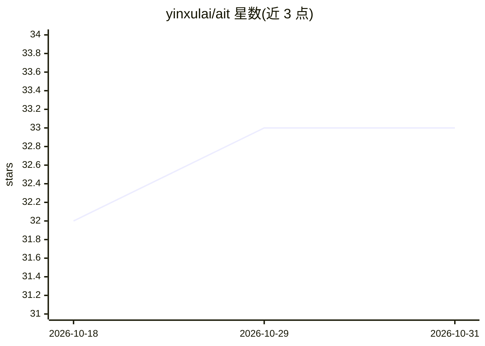

# yinxulai/ait

⭐ 33 · Go · MIT · 推送 2026-06-29 · [GitHub](https://github.com/yinxulai/ait) · 个人维护 · 中文 README

**CLI 工具：批量测试 OpenAI/Anthropic 协议模型的性能指标**

用于批量测试兼容 OpenAI 协议与 Anthropic 协议的 AI 模型服务性能的 CLI 工具，可测量 TTFT（首字节时间）、TPS（吞吐量）、DNS、连接、TLS 握手等网络指标，默认支持流式响应，并提供多模型对比与 JSON/CSV 报告生成。面向需要评估模型 API 服务性能的开发者。提供交互式 TUI、Web UI 与 MCP 三种运行模式，MCP 模式内置 4 个工具供 AI 客户端调用任务管理。通过安装脚本或直接下载二进制安装，也可从源码编译。

## 筛选速览

| 维度 | 判定 | 备注 |
|---|---|---|
| AI 角色 | `ai-ecosystem` | LLM/agent 周边工具 |
| 许可风险 | `permissive` | MIT |
| 部署形态 | `desktop` | 安装包/桌面程序 |
| 模型依赖 | — | README 未给出锁定关系 |
| 硬件要求 | — | 无带数字的原话,不猜 |
| 安装摩擦 | `medium` | 含编译或系统依赖之一 |
| 成熟度 | — | 结构信号不足 |

## 能力要点

- 支持 OpenAI 与 Anthropic 两种协议
- 测量 TTFT、TPS 及 DNS/连接/TLS 握手等网络指标
- TUI/Web UI/MCP 三种运行模式，MCP 内置 4 个任务管理工具
- 生成 JSON 与 CSV 格式的测试报告

## 适用场景

- 对比多个模型 API 服务的响应性能
- 通过 TUI 或 Web UI 管理和运行压测任务
- 让 AI 客户端经 MCP 调用创建和运行测试任务

## 场景标签

`模型评测` · 领域:评测与运维

## 证据(README 行号)

> L6: 一个强大的 CLI 工具，用于批量测试符合 OpenAI 协议和 Anthropic 协议的 AI 模型性能指标。默认启动交互式终端任务中心（TUI），也可通过 MCP 协议供 AI 客户端调用。
> L15: - 📄 **多格式报告**: 支持生成 JSON 和 CSV 格式的详细测试报告

## 星数曲线

2026-10-18 32 → 2026-10-31 33（+1）

---
*卡片 v1 · prompt 1.4 · 生成 2026-10-25 · 置信度 high · 依据 README sha `0213e063b190` · [字段定义](../../DATASET.md)*
