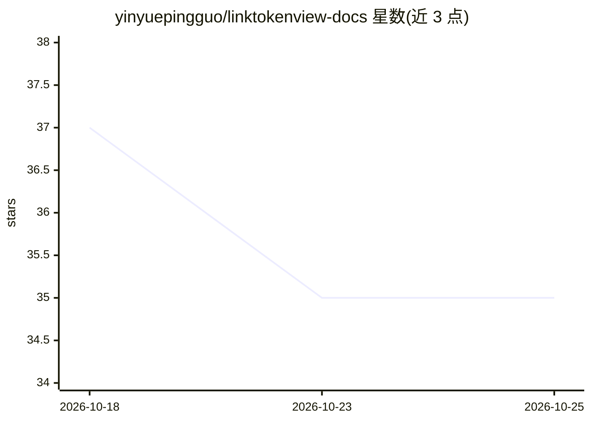

# yinyuepingguo/linktokenview-docs

⭐ 35 · HTML · Apache-2.0 · 推送 2026-09-24 · [GitHub](https://github.com/yinyuepingguo/linktokenview-docs) · [官网](https://linktokenview.com) · 组织维护 · 中文 README

**面向开发者的国产大模型 Token API 聚合平台（内测中）**

LinkTokenView（联视未来）是一个国产大模型 API 聚合平台，处于内测阶段：通过一个 OpenAI 兼容接口和单一 API Key 调用 DeepSeek、通义千问、Kimi、豆包、智谱 GLM、百川、讯飞星火、MiMo、阶跃星辰等首批接入的 9 家国产模型，Token 余额跨模型统一调度。计费含按量计费、Token 预付包与企业专线。多渠道按优先级调度并在异常时自动降级。支持接入 Claude Code、Codex、CC Switch 等 Agent 工具；README 声明仅接入国产大模型，不提供境外模型服务。本仓库为帮助文档源文件（Docsify）。

## 筛选速览

| 维度 | 判定 | 备注 |
|---|---|---|
| AI 角色 | `ai-ecosystem` | LLM/agent 周边工具 |
| 许可风险 | `permissive` | Apache-2.0 |
| 部署形态 | `None` |  |
| 模型依赖 | locked-api |  |
| 硬件要求 | — | 无带数字的原话,不猜 |
| 安装摩擦 | `low` | 无编译、无系统依赖或容器化 |
| 成熟度 | `idea` | |

## 能力要点

- 统一 OpenAI 兼容接口，单一 API Key 跨 9 家国产模型通用
- Token 余额跨模型统一调度，按量计费与 Token Plan 预付包
- 多渠道优先级调度、异常自动降级与恢复回池
- 支持 Claude Code、Codex、CC Switch、WorkBuddy 等 Agent 工具接入

## 适用场景

- 现有 OpenAI SDK 项目仅替换 Base URL 即可切换到国产模型
- 用一个 Key 和一份余额在多家国产模型间切换调用
- 为 Claude Code、Codex 等 Agent 工具配置国产模型后端

## 场景标签

`模型网关` · 领域:Agent 开发

## 证据(README 行号)

> L8: **LinkTokenView（联视未来）是一个国产大模型 API 聚合平台，现已正式开启内测。** 一个 OpenAI 兼容接口即可调用 DeepSeek、通义千问、Kimi、豆包、智谱 GLM、百川、讯飞星火、MiMo、阶跃星辰
> L30: - **一个接口，多种模型**：统一 OpenAI 兼容接口，新增模型无需改动业务代码，现有项目替换 Base URL 即可接入。
> L92: Claude Code、Codex、CC Switch、WorkBuddy 等工具的配置步骤见 Agent 工具接入概览。

## 星数曲线

2026-10-18 37 → 2026-10-25 35（-2）

---
*卡片 v1 · prompt 1.4 · 生成 2026-10-25 · 置信度 high · 依据 README sha `f538aef64b68` · [字段定义](../../DATASET.md)*
