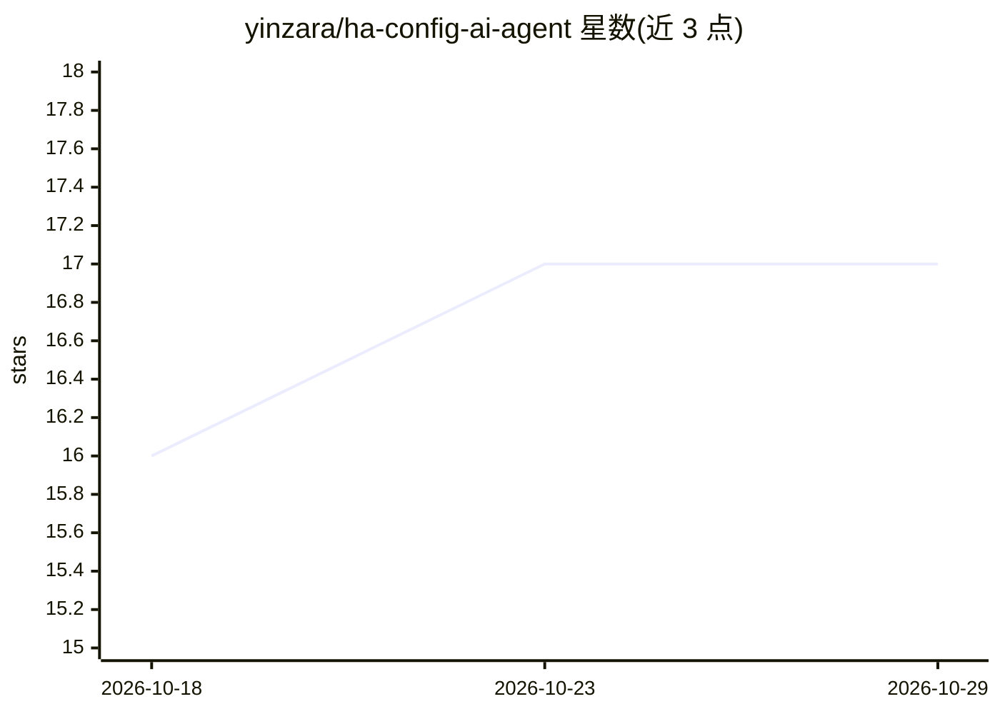

# yinzara/ha-config-ai-agent

⭐ 17 · Python · MIT · 推送 2026-05-05 · [GitHub](https://github.com/yinzara/ha-config-ai-agent) · 个人维护

**Home Assistant 配置 AI 助手插件，自然语言改配置并带审批流**

Home Assistant 的 HACS 插件（add-on），让用户用自然语言对话方式查询和修改配置：如启用集成调试日志、重命名设备、创建日落开灯自动化等。修改前展示可视化 diff 供审批，应用时自动备份、校验并支持回滚，改动后配置自动重载。支持 OpenAI、OpenRouter、Ollama、Azure 或任意 OpenAI 兼容 API 作为后端，覆盖自动化、脚本、Lovelace、设备、实体与区域管理。安装经 HACS 搜索插件后重启，再在集成设置中填 API key。

## 筛选速览

| 维度 | 判定 | 备注 |
|---|---|---|
| AI 角色 | `ai-enhanced` | 去掉 AI 部分产品仍成立 |
| 许可风险 | `permissive` | MIT |
| 部署形态 | `None` |  |
| 模型依赖 | local-ok | 支持本地模型 |
| 硬件要求 | — | 无带数字的原话,不猜 |
| 安装摩擦 | `low` | 无编译、无系统依赖或容器化 |
| 成熟度 | — | 结构信号不足 |

## 能力要点

- 自然语言查询与修改 Home Assistant 配置，无需 YAML 经验
- 审批工作流：应用前查看可视化 diff
- 自动备份、校验与回滚机制
- 支持 OpenAI/OpenRouter/Ollama/Azure 等多种 AI 提供方

## 适用场景

- 不想写 YAML，用对话方式创建或修改自动化
- 查看和管理现有的自动化、脚本与设备配置
- 安全地试改配置，改错可回滚

## 场景标签

 · 领域:智能家居/配置工具

## 证据(README 行号)

> L1: This is the repository for the Home Assistant Configuration AI Agent add-on.
> L25: * 🤖 **Natural Language Interface** - No YAML expertise required

## 星数曲线

2026-10-18 16 → 2026-10-29 17（+1）

---
*卡片 v1 · prompt 1.4 · 生成 2026-10-29 · 置信度 high · 依据 README sha `2913af99c6b0` · [字段定义](../../DATASET.md)*
