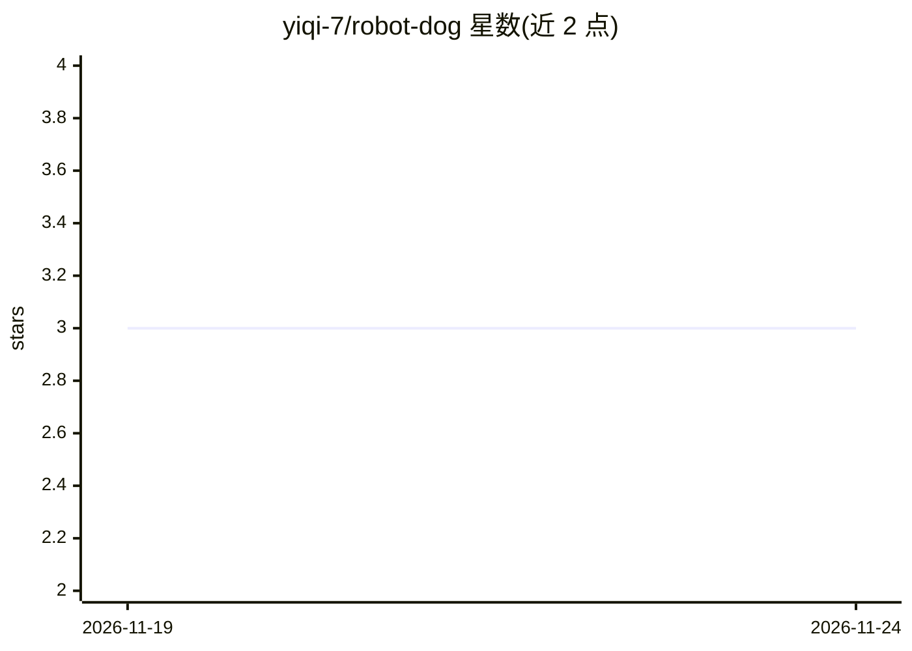

# yiqi-7/robot-dog

⭐ 4 · C++ · NOASSERTION · 推送 2026-11-23 · [GitHub](https://github.com/yiqi-7/robot-dog) · 个人维护 · 中文 README

**仿真四足巡检机器人：浏览器看板派任务、看遥测**

在 Gazebo 虚拟厂区运行 ROS 2 四足巡检机器人，浏览器看板派发任务、查看地图、遥测与告警。仿真链路组合 CHAMP 步态、Nav2 导航与 SLAM，运维侧经 MQTT 上报，含 WebRTC 视频与语音链路（Opus→ASR→大模型决策）。README 说明目前仅在仿真环境验证，且 Nav2 避障只覆盖导航链路，独立近距离急停未启用。支持本地全栈与云端中转两种部署，MIT 许可证。

## 筛选速览

| 维度 | 判定 | 备注 |
|---|---|---|
| AI 角色 | `ai-enhanced` | 去掉 AI 部分产品仍成立 |
| 许可风险 | `none` | NOASSERTION |
| 部署形态 | `None` |  |
| 模型依赖 | — | README 未给出锁定关系 |
| 硬件要求 | — | 无带数字的原话,不猜 |
| 安装摩擦 | `low` | 无编译、无系统依赖或容器化 |
| 成熟度 | — | 结构信号不足 |

## 能力要点

- 浏览器看板派发巡检任务并展示地图、遥测与告警
- CHAMP 步态 + Nav2 导航 + SLAM 的完整仿真链路
- 语音链路 Opus→ASR→大模型决策，WebRTC 视频传输
- 本地全栈与云端中转两种部署方式

## 适用场景

- 仿真厂区四足机器人建图、定位与航点巡逻验证
- 通过 Web 看板集中监控多台机器人的电量等遥测
- 搭建机器人运维 MQTT/视频数据链路的参考实现

## 场景标签

`语音识别` · 领域:感知与多模态

## 证据(README 行号)

> L3: 在 Gazebo 的虚拟厂区里运行四足巡检机器人，用浏览器看板派发任务、查看地图、遥测和告警。项目目前只在仿真环境中验证。
> L27: - 完整仿真：在 Ubuntu 26.04 上运行 ROS 2 Lyrical、Gazebo Sim 10、CHAMP 和 Nav2，体验建图、定位与航点巡逻。

## 星数曲线

2026-11-19 3 → 2026-11-24 3（+0）

---
*卡片 v1 · prompt 1.4 · 生成 2026-11-21 · 置信度 high · 依据 README sha `3d178a609bc7` · [字段定义](../../DATASET.md)*
