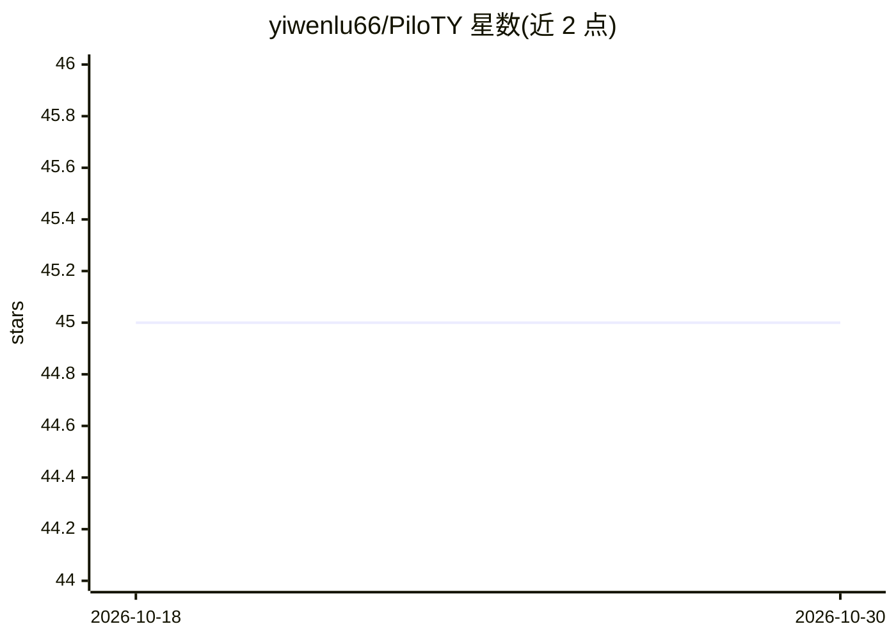

# yiwenlu66/PiloTY

⭐ 45 · Python · NOASSERTION · 推送 2026-04-23 · [GitHub](https://github.com/yiwenlu66/PiloTY) · 个人维护

**给 AI agent 提供持久交互式终端的 MCP 服务器**

PiloTY 是一个 MCP server，通过 stdio 由 MCP 客户端启动，为 agent 提供跨工具调用持久存活的交互式终端（PTY）：工作目录、环境变量、前台进程、SSH 连接与 REPL 状态均可保持。提供 send_line/wait_for_output/wait_for_regex/snapshot_screen 等工具，区分调用结果与终端状态推断（running/ready/password/repl 等），并用静默策略收集输出。会话日志写入 ~/.piloty/，可用 session_viewer.py 检查。注意其暴露无限制终端访问，终端状态检测为尽力而为。

## 筛选速览

| 维度 | 判定 | 备注 |
|---|---|---|
| AI 角色 | `ai-ecosystem` | LLM/agent 周边工具 |
| 许可风险 | `none` | NOASSERTION |
| 部署形态 | `None` |  |
| 模型依赖 | — | README 未给出锁定关系 |
| 硬件要求 | — | 无带数字的原话,不猜 |
| 安装摩擦 | `low` | 无编译、无系统依赖或容器化 |
| 成熟度 | — | 结构信号不足 |

## 能力要点

- 跨工具调用持久化的 PTY 会话（cwd/环境变量/进程/SSH 状态保持）
- 输出流与渲染屏幕双表示，含 screen/scrollback 快照工具
- 终端状态推断（password/confirm/repl/editor/pager 等）与自定义提示符正则
- 会话日志（transcript/commands/interaction）与 session_viewer 检查工具

## 适用场景

- 让 Codex/Claude Code 等 agent 驱动长运行的构建、测试与迁移
- 保持 SSH 远程会话跨工具调用存活，执行远程运维
- 让 agent 在持久 REPL/调试器中交互式调试代码
- 处理 sudo/SSH 等交互式密码提示

## 场景标签

 · 领域:开发者工具/agent 基础设施

## 证据(README 行号)

> L5: PiloTY (PTY for your AI Copilot) is an MCP server that gives an agent a persistent, interactive terminal.
> L24: PiloTY is meant to be launched by an MCP client over stdio.

## 星数曲线

2026-10-18 45 → 2026-10-30 45（+0）

---
*卡片 v1 · prompt 1.4 · 生成 2026-10-25 · 置信度 high · 依据 README sha `69031df39394` · [字段定义](../../DATASET.md)*
