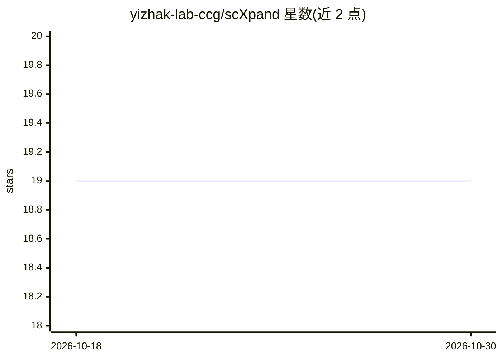

# yizhak-lab-ccg/scXpand

⭐ 19 · Python · MIT · 推送 2026-08-11 · [GitHub](https://github.com/yizhak-lab-ccg/scXpand) · [官网](https://scxpand.readthedocs.io) · 组织维护

**从单细胞RNA测序数据检测T细胞克隆性扩增的Python工具**

预测框架：无需配对TCR测序，仅用scRNA-seq数据预测T细胞克隆性扩增，面向泛癌症研究场景。提供Autoencoder、MLP、LightGBM、Logistic Regression、SVM多种模型架构，支持从磁盘流式读取处理百万级细胞，内置基于Optuna的自动超参数优化。输入要求raw UMI counts的h5ad数据（仅含T细胞），不支支持归一化或log转换数据。提供预训练模型推理与自训练两种用法，含CLI与编程API。发表于Cell Genomics，属scverse生态。

## 筛选速览

| 维度 | 判定 | 备注 |
|---|---|---|
| AI 角色 | `ai-native` | 本体是模型或模型工具 |
| 许可风险 | `permissive` | MIT |
| 部署形态 | `library` | 以包/库形式分发 |
| 模型依赖 | — | README 未给出锁定关系 |
| 硬件要求 | — | 无带数字的原话,不猜 |
| 安装摩擦 | `low` | 无编译、无系统依赖或容器化 |
| 成熟度 | — | 结构信号不足 |

## 能力要点

- 无需配对TCR测序即可检测T细胞克隆性扩增
- 五种模型架构（Autoencoder/MLP/LightGBM/LR/SVM）
- 磁盘流式读取处理百万级细胞
- 内置Optuna自动超参数优化

## 适用场景

- 在没有TCR测序数据时从scRNA-seq推断T细胞克隆扩增
- 用预训练模型对新单细胞数据做扩增预测
- 在自有数据上训练自定义克隆性扩增检测模型

## 场景标签

 · 领域:生物信息学/单细胞免疫学

## 证据(README 行号)

> L15:  Detect T-cell clonal expansion from single-cell RNA sequencing data without paired TCR sequencing
> L26: A framework for predicting T-cell clonal expansion from single-cell RNA sequencing data.

## 星数曲线

2026-10-18 19 → 2026-10-30 19（+0）

---
*卡片 v1 · prompt 1.4 · 生成 2026-10-28 · 置信度 high · 依据 README sha `2f34212d3184` · [字段定义](../../DATASET.md)*
