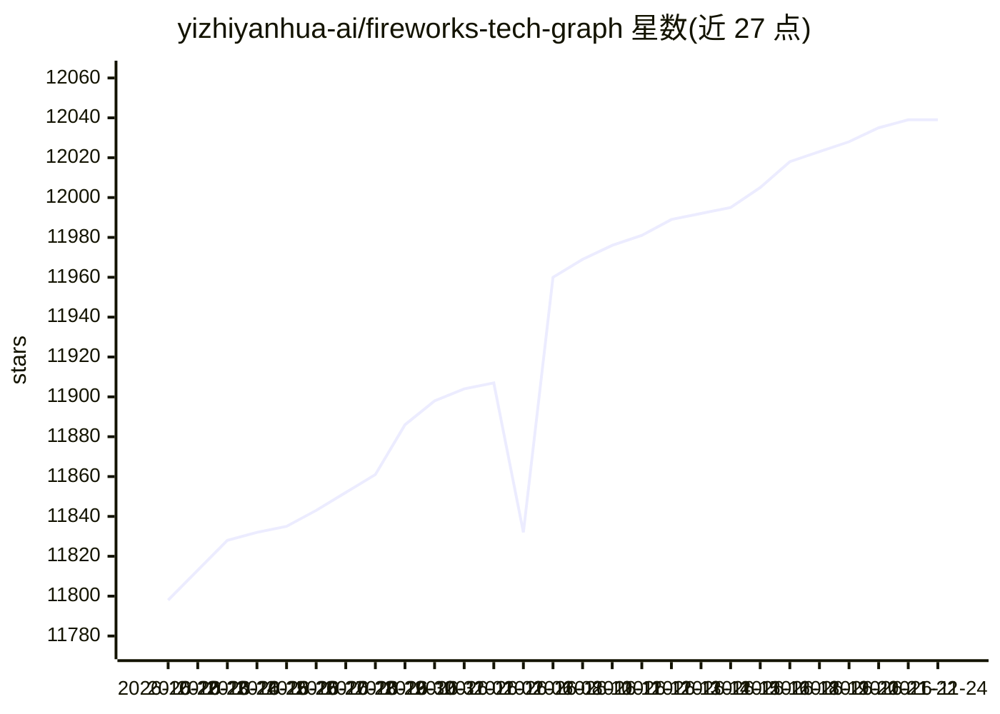

# yizhiyanhua-ai/fireworks-tech-graph

⭐ 12,043 · Python · MIT · 推送 2026-10-21 · [GitHub](https://github.com/yizhiyanhua-ai/fireworks-tech-graph) · [官网](https://yizhiyanhua-ai.github.io/fireworks-tech-graph/) · 个人维护 · 中文 README

**给开发者的自然语言转工程图表工具：生成 SVG/PNG 技术架构图**

以 Agent Skill 形式运行于 Codex 与 Claude Code 的图表生成工具：接收英文或中文自然语言描述，经分类路由、Diagram Contract、语义 IR 后生成经过几何校验的 SVG、1920px PNG、SVG-to-GIF 动图与离线交互式 HTML。内置 11 个生成器风格加 1 个 AI 编写风格，支持 14 种 UML 图与 RAG、Multi-Agent、Tool Call 等 AI/Agent 领域图式。渲染后进入有界验证反馈环：先做 XML/几何等确定性检查，再读回 PNG 做感知校验，默认最多两轮定向修正；运行时无法读图时明确报告 visual_review 跳过。

## 筛选速览

| 维度 | 判定 | 备注 |
|---|---|---|
| AI 角色 | `ai-native` | 本体是模型或模型工具 |
| 许可风险 | `permissive` | MIT |
| 部署形态 | `library` | 以包/库形式分发 |
| 模型依赖 | — | README 未给出锁定关系 |
| 硬件要求 | — | 无带数字的原话,不猜 |
| 安装摩擦 | `low` | 无编译、无系统依赖或容器化 |
| 成熟度 | — | 结构信号不足 |

## 能力要点

- 12 种视觉风格、14 种图类型（含全部 UML）与 AI/Agent 领域模式
- 带验证反馈环：确定性检查+PNG 读回的感知校验，默认最多两轮修正
- 几何安全布线：确定性正交路由、精确路点、标签不越界、桥式交叉
- 统一 CLI，导出离线交互 HTML（平移/缩放/主题/多格式导出）

## 适用场景

- 用自然语言生成微服务或云部署架构图
- 为 AI/Agent 工作流（RAG、多智能体、工具调用）画说明图
- 生成 C4 评审、事件流拓扑、可靠性观测等技术评审图
- 导出 SVG 编辑用图与 1920px PNG 嵌入文档

## 场景标签

`代码生成` · 领域:编码与开发

## 证据(README 行号)

> L30: `fireworks-tech-graph` is one Agent Skill that works unchanged in **Codex and Claude Code**. It turns natural langu
> L137: - **14 diagram types** — Full UML support (Class, Component, Deployment, Package, Composite Structure, Object, Use
> L154: The first render is treated as a candidate, not an automatic final result. `fireworks-tech-graph` uses an agent-dr

## 星数曲线

2026-10-22 11,798 → 2026-11-24 12,039（+241）

---
*卡片 v1 · prompt 1.4 · 生成 2026-11-22 · 置信度 mid · 依据 README sha `6a6146ac0c37` · [字段定义](../../DATASET.md)*
