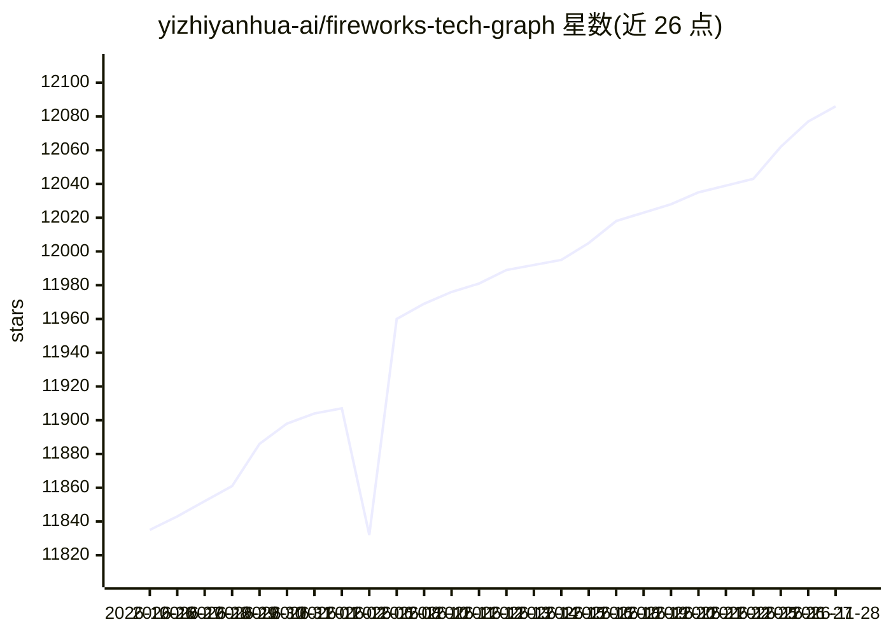

# yizhiyanhua-ai/fireworks-tech-graph

⭐ 12,086 · Python · MIT · 推送 2026-11-26 · [GitHub](https://github.com/yizhiyanhua-ai/fireworks-tech-graph) · [官网](https://yizhiyanhua-ai.github.io/fireworks-tech-graph/) · 个人维护 · 中文 README

**用自然语言生成工程级 SVG/PNG 技术图表的 Agent Skill**

以 Agent Skill 形式在 Codex 与 Claude Code 中运行的图表生成工具：用户用英文或中文描述系统，输出经几何校验的 SVG、高分辨率 PNG、SVG 转 GIF 动画与离线交互式 HTML。内置 12 种视觉风格、14 种图表类型与完整 UML 支持，并预置 RAG、Multi-Agent、Tool Call 等 AI/Agent 领域模式。生成流程采用带界验证反馈环：先做确定性几何/XML 检查，再回读 PNG 做感知校验，默认最多两轮定向修正；支持 Draw.io 与 Excalidraw 导入导出。

## 筛选速览

| 维度 | 判定 | 备注 |
|---|---|---|
| AI 角色 | `ai-native` | 本体是模型或模型工具 |
| 许可风险 | `permissive` | MIT |
| 部署形态 | `library` | 以包/库形式分发 |
| 模型依赖 | — | README 未给出锁定关系 |
| 硬件要求 | — | 无带数字的原话,不猜 |
| 安装摩擦 | `low` | 无编译、无系统依赖或容器化 |
| 成熟度 | — | 结构信号不足 |

## 能力要点

- 12 种视觉风格（11 种生成器支持 + 1 种 AI 撰写）与 14 种 UML 图表类型
- AI/Agent 领域图表模式：RAG、Agentic Search、Mem0、Multi-Agent、Tool Call
- 带界验证反馈环：确定性检查 + PNG 回读感知校验，最多两轮定向修正
- 支持 Draw.io / Excalidraw 导入导出及离线交互式 HTML（pan/zoom/多格式导出）

## 适用场景

- 在 Claude Code / Codex 中用自然语言生成架构图
- 绘制 AI/Agent 工作流（RAG、多智能体、工具调用）示意图
- 生成 1920px PNG 用于文档或演示嵌入
- 与 Draw.io / Excalidraw 之间转换图表资产

## 场景标签

 · 领域:开发者工具/图表生成

## 证据(README 行号)

> L30: `fireworks-tech-graph` is one Agent Skill that works unchanged in **Codex and Claude Code**. It turns natural langu
> L137: - **14 diagram types** — Full UML support (Class, Component, Deployment, Package, Composite Structure, Object, Use
> L154: The first render is treated as a candidate, not an automatic final result. `fireworks-tech-graph` uses an agent-dr

## 星数曲线

2026-10-26 11,835 → 2026-11-28 12,086（+251）

---
*卡片 v1 · prompt 1.4 · 生成 2026-11-27 · 置信度 low · 依据 README sha `94a312eb667c` · [字段定义](../../DATASET.md)*
