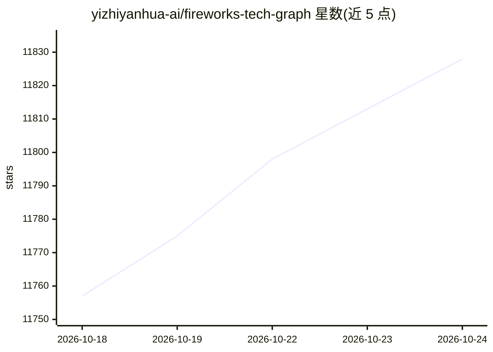

# yizhiyanhua-ai/fireworks-tech-graph

⭐ 11,832 · Python · MIT · 推送 2026-10-21 · [GitHub](https://github.com/yizhiyanhua-ai/fireworks-tech-graph) · [官网](https://yizhiyanhua-ai.github.io/fireworks-tech-graph/) · 个人维护 · 中文 README

**从自然语言生成技术图表的 Agent 技能（SVG/PNG/GIF/HTML）**

一个同时适配 Codex 与 Claude Code 的 Agent Skill：把英文或中文的自然语言描述转为经几何校验的 SVG 图表，并导出高分辨率 PNG、SVG 转 GIF 动画与离线交互 HTML。提供 12 种视觉风格（11 种生成器风格 + 1 种 AI 创作）、14 种图表类型（含全部 UML）与 RAG/Multi-Agent 等 AI 领域图式；渲染前执行工程语义契约、几何与 SVG 校验，默认最多两轮视觉修正。通过 npx skills CLI 或 git clone 安装到技能目录运行。

## 筛选速览

| 维度 | 判定 | 备注 |
|---|---|---|
| AI 角色 | `ai-native` | 本体是模型或模型工具 |
| 许可风险 | `permissive` | MIT |
| 部署形态 | `library` | 以包/库形式分发 |
| 模型依赖 | locked-api |  |
| 硬件要求 | — | 无带数字的原话,不猜 |
| 安装摩擦 | `low` | 无编译、无系统依赖或容器化 |
| 成熟度 | — | 结构信号不足 |

## 能力要点

- 自然语言→几何校验 SVG + 1920px PNG + 语义 GIF 动画
- 12 种视觉风格、14 种图表类型（含全部 UML）
- C4/部署/事件流/可靠性四类工程语义契约，渲染前 fail closed
- 有界验证回路：确定性检查 + 视觉复核，最多两轮修正

## 适用场景

- 用一句话生成系统架构或 UML 图，不手工画图
- 在 Codex 或 Claude Code 里为技术文档产出配图
- 生成 RAG、Multi-Agent、Tool Call 等 AI 架构示意与动图

## 场景标签

`图像生成` · 领域:内容生成

## 证据(README 行号)

> L30: `fireworks-tech-graph` is one Agent Skill that works unchanged in **Codex and Claude Code**. It turns natural langu
> L33: User: "Generate a Mem0 memory architecture diagram, dark style"

## 星数曲线

2026-10-18 11,757 → 2026-10-24 11,828（+71）

---
*卡片 v1 · prompt 1.4 · 生成 2026-10-20 · 置信度 mid · 依据 README sha `c34748116ba5` · [字段定义](../../DATASET.md)*
