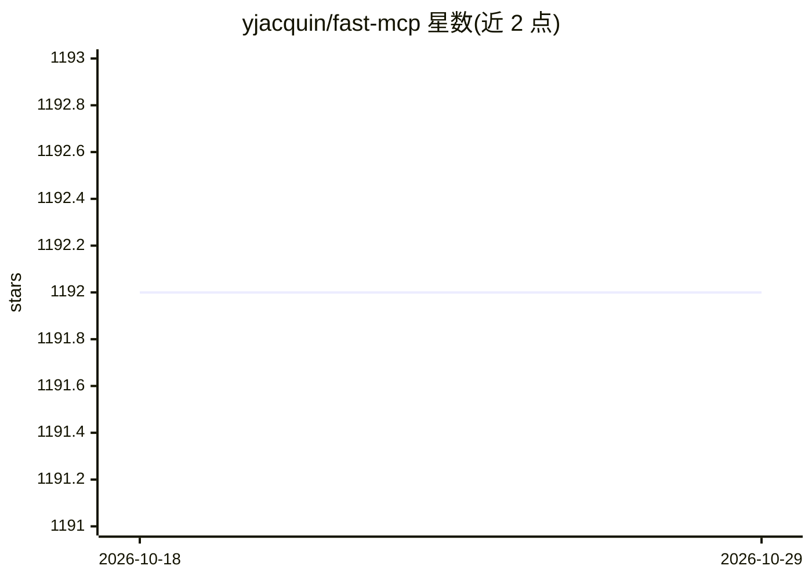

# yjacquin/fast-mcp

⭐ 1,192 · Ruby · MIT · 推送 2025-12-15 · [GitHub](https://github.com/yjacquin/fast-mcp) · 个人维护

**MCP 协议的 Ruby 实现：让 AI 模型调用 Ruby 应用功能**

Model Context Protocol 的 Ruby 语言实现库，以 Gem 形式提供：通过 Tools API 让 AI 模型安全调用 Ruby 函数（Dry-Schema 参数校验）、Resources API 共享数据，支持 STDIO/HTTP/SSE 三种传输。可与 Rails、Sinatra 或任意 Rack 应用集成，Rails 提供生成器与 ActionTool::Base 等命名别名。内置 DNS 重绑定防护与 token 认证，支持按请求上下文动态过滤工具/资源。要求 Ruby 3.2+，可接入 Claude Desktop、Cursor 等 MCP 客户端。

## 筛选速览

| 维度 | 判定 | 备注 |
|---|---|---|
| AI 角色 | `ai-ecosystem` | LLM/agent 周边工具 |
| 许可风险 | `permissive` | MIT |
| 部署形态 | `library` | 以包/库形式分发 |
| 模型依赖 | — | README 未给出锁定关系 |
| 硬件要求 | — | 无带数字的原话,不猜 |
| 安装摩擦 | `low` | 无编译、无系统依赖或容器化 |
| 成熟度 | — | 结构信号不足 |

## 能力要点

- Tools/Resources API，Dry-Schema 参数校验
- STDIO/HTTP/SSE 多种传输
- Rails 生成器与 Rack 中间件集成（含 Sinatra/Hanami）
- DNS 重绑定防护与 token 认证、动态工具过滤

## 适用场景

- 在 Rails/Rack 应用中暴露工具与资源供 LLM 调用
- 为 Claude Desktop 或 Cursor 搭配本地 MCP 服务
- 用 MCP 作为微服务间通信协议

## 场景标签

`Agent 框架` · 领域:Agent 开发

## 证据(README 行号)

> L3:  Connect AI models to your Ruby applications with ease
> L21: Fast MCP solves all these problems by providing a clean, Ruby-focused implementation of the Model Context Protocol,

## 星数曲线

2026-10-18 1,192 → 2026-10-29 1,192（+0）

---
*卡片 v1 · prompt 1.4 · 生成 2026-10-21 · 置信度 mid · 依据 README sha `21d2f8031a07` · [字段定义](../../DATASET.md)*
