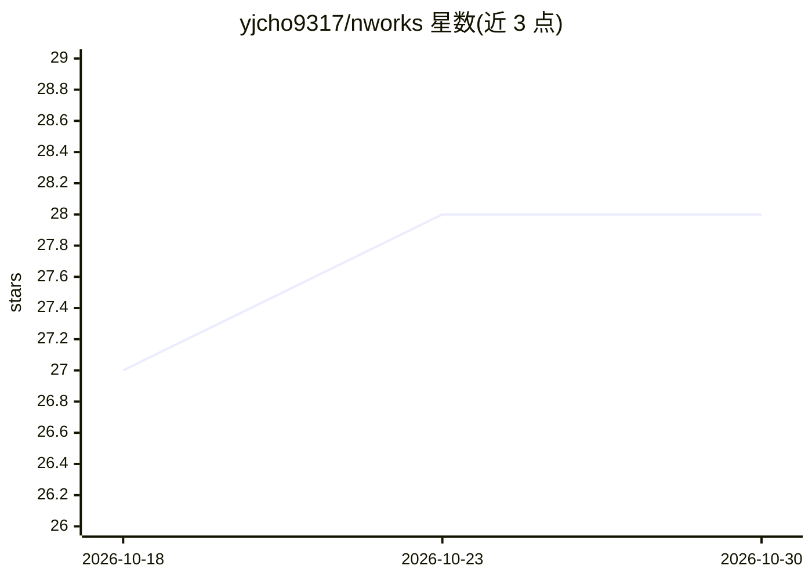

# yjcho9317/nworks

⭐ 28 · TypeScript · Apache-2.0 · 推送 2026-09-19 · [GitHub](https://github.com/yjcho9317/nworks) · 个人维护 · 中文 README

**LINE WORKS 的 MCP 服务器与 CLI，供 AI 代理操作办公套件**

面向 LINE WORKS（NAVER WORKS）的非官方社区维护工具，同时提供 MCP 服务器与 CLI 两种形态：覆盖消息、日历、云盘、邮件、任务、看板、联系人共 36 个工具。AI 代理（Claude Desktop、Cursor 等 MCP 客户端）经由 User OAuth 或 Service Account 调用这些工具操作 LINE WORKS；CLI 支持 --json 与 --dry-run，可用于脚本与 CI/CD 通知。使用前需在 Developer Console 创建应用并配置 Client ID/Secret，bot 消息需管理员审批。以 npm 全局安装运行。

## 筛选速览

| 维度 | 判定 | 备注 |
|---|---|---|
| AI 角色 | `ai-ecosystem` | LLM/agent 周边工具 |
| 许可风险 | `permissive` | Apache-2.0 |
| 部署形态 | `library` | 以包/库形式分发 |
| 模型依赖 | — | README 未给出锁定关系 |
| 硬件要求 | — | 无带数字的原话,不猜 |
| 安装摩擦 | `low` | 无编译、无系统依赖或容器化 |
| 成熟度 | — | 结构信号不足 |

## 能力要点

- 36 个工具覆盖消息/日历/云盘/邮件/任务/看板/联系人
- 同时提供 CLI 与 MCP server，一次登录启用全部工具
- CLI 支持 --json 输出与 --dry-run 测试模式
- scope preset（all/readonly）与 token 权限合并机制

## 适用场景

- 让 Claude/Cursor 等 MCP 客户端代为操作 LINE WORKS 日程、邮件与消息
- 在 CI/CD 流水线中向团队频道发送部署通知
- 用 CLI 脚本批量执行站会提醒等团队自动化

## 场景标签

`工作流自动化` · 领域:效率与自动化

## 证据(README 行号)

> L14: Full-featured MCP server for LINE WORKS (NAVER WORKS).
> L17: nworks lets **external** AI agents (Claude, Cursor) and your terminal *operate* LINE WORKS from the outside — compl
> L60: Works with Claude Desktop, Cursor, and other MCP-compatible clients.

## 星数曲线

2026-10-18 27 → 2026-10-30 28（+1）

---
*卡片 v1 · prompt 1.4 · 生成 2026-10-26 · 置信度 high · 依据 README sha `3a69cc6fc8eb` · [字段定义](../../DATASET.md)*
