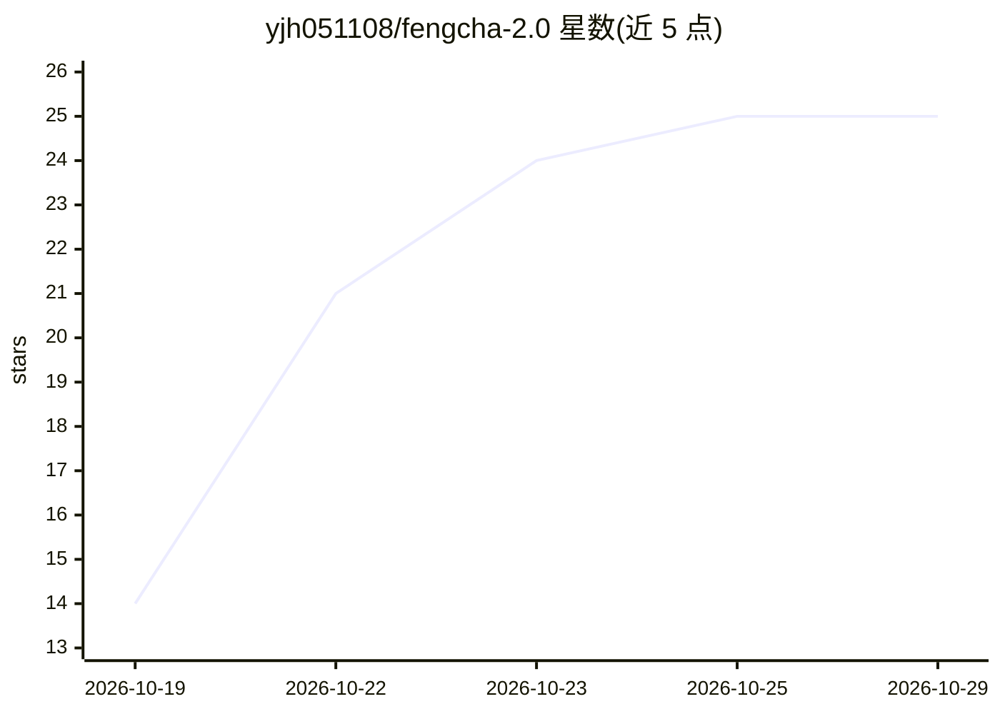

# yjh051108/fengcha-2.0

⭐ 25 · JavaScript · Apache-2.0 · 推送 2026-10-21 · [GitHub](https://github.com/yjh051108/fengcha-2.0) · 个人维护 · 中文 README

**DeepSeek Harness 预设插件：让模型思考用第一人称复数**

面向 DeepSeek Harness（DSH）的 agent 预设插件，提供「风插标准」「风插 PTC」「风插 匠人」三个预设。机制：在 runtime-context 快照的头尾各注入一次形式化硬指令，要求推理过程以 We/Our/Let's 开头。实测思考块「我们」类词占比从 3% 升至 81%；README 明确声明未测正确率、代码质量、延迟与费用，实验仅基于 deepseek-v4.1-flash、每组 10 个样本。通过 DSH 插件管理器或 git clone + pnpm 手动安装，附 50 余个可复现实验脚本。

## 筛选速览

| 维度 | 判定 | 备注 |
|---|---|---|
| AI 角色 | `ai-ecosystem` | LLM/agent 周边工具 |
| 许可风险 | `permissive` | Apache-2.0 |
| 部署形态 | `library` | 以包/库形式分发 |
| 模型依赖 | locked-api |  |
| 硬件要求 | — | 无带数字的原话,不猜 |
| 安装摩擦 | `low` | 无编译、无系统依赖或容器化 |
| 成熟度 | — | 结构信号不足 |

## 能力要点

- 在 runtime-context 快照头尾注入形式化约束（0.81 vs 只放结尾 0.56）
- 提供 3 个预设：standard / PTC 能力集复制 + 匠人人格变体
- 8 种写法与位置消融实验，公开失败结果与样本量边界
- experiments/ 内 50 余个可复现脚本

## 适用场景

- 让 DSH 中的模型思考口吻变为第一人称复数
- 研究者复现提示词位置与措辞的消融实验
- 对比硬指令与氛围描述对推理风格的影响

## 场景标签

`提示工程` · 领域:Agent 开发

## 证据(README 行号)

> L5: > 这是一个 DeepSeek Harness（DSH）的预设。装上之后，你会在模型的「思考过程」里
> L26: git clone https://github.com/yjh051108/fengcha-2.0
> L183: 2. **只测了一个模型。** 全部实验在 `deepseek-v4.1-flash` 上做的。

## 星数曲线

2026-10-19 14 → 2026-10-29 25（+11）

---
*卡片 v1 · prompt 1.4 · 生成 2026-10-26 · 置信度 high · 依据 README sha `ca65e91a836a` · [字段定义](../../DATASET.md)*
