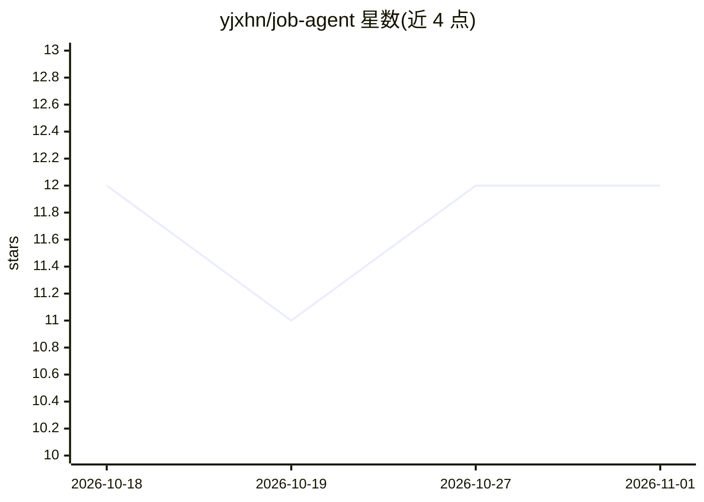

# yjxhn/job-agent

⭐ 12 · Python · MIT · 推送 2026-08-30 · [GitHub](https://github.com/yjxhn/job-agent) · 个人维护 · 中文 README

**面向求职者的 LLM 求职 Agent：搜岗、精排、简历定制与投递追踪**

自动化求职工具（Python 包 agent_core），流程为多平台并发搜岗（Boss 直聘/猎聘/智联三家招聘平台 + 腾讯/网易/比亚迪/北方华创/长飞光纤五家官网 API，共 8 源）→ Dashboard 人工初筛标记 → LLM 精排评分（并发 5，JSON 强制 + 重试）→ 简历定制（.docx/.md）→ 7 阶段投递状态机追踪，另含模拟面试、Offer 评估、薪资谈判与对话模式（DeepSeek function-calling 调 11 个工具）。LLM 依赖 DEEPSEEK_API_KEY；招聘平台需手动导出 Cookie，Boss 存在 code-37 反爬与短效 Cookie 限制。

## 筛选速览

| 维度 | 判定 | 备注 |
|---|---|---|
| AI 角色 | `ai-native` | 本体是模型或模型工具 |
| 许可风险 | `permissive` | MIT |
| 部署形态 | `library` | 以包/库形式分发 |
| 模型依赖 | locked-api |  |
| 硬件要求 | — | 无带数字的原话,不猜 |
| 安装摩擦 | `low` | 无编译、无系统依赖或容器化 |
| 成熟度 | — | 结构信号不足 |

## 能力要点

- 8 个职位源并发搜索 + 跨平台去重（公司别名表 + 标准化标题）
- LLM 精排百分制评分 + 缺口分析，JSON 强制 + 重试
- 生成定制简历(.docx+.md)、HR 打招呼消息、面试题预测
- 对话模式经 DeepSeek function-calling 调用 11 个工具

## 适用场景

- 跨多个招聘平台自动搜集并去重目标岗位
- 让 LLM 对想投的岗位做匹配评分和简历定制
- 用 Dashboard 追踪投递进度并做模拟面试与 Offer 评估

## 场景标签

`网页抓取` `AI 写作` · 领域:效率与自动化

## 证据(README 行号)

> L7: 自动搜职位→人工筛选→LLM精排匹配→简历定制→投递追踪的智能求职助手。
> L23: 求职 AI Agent（包名 `agent_core`）是一个自动化求职工具，从职位搜索到投递追踪全流程覆盖。支持多平台并发搜索、跨平台去重、人工筛选、LLM 精排匹配、简历定制和投递状态追踪。底层使用 DS 作为 LLM（通过 

## 星数曲线

2026-10-18 12 → 2026-11-01 12（+0）

---
*卡片 v1 · prompt 1.4 · 生成 2026-11-01 · 置信度 high · 依据 README sha `0af4e2e79ac1` · [字段定义](../../DATASET.md)*
