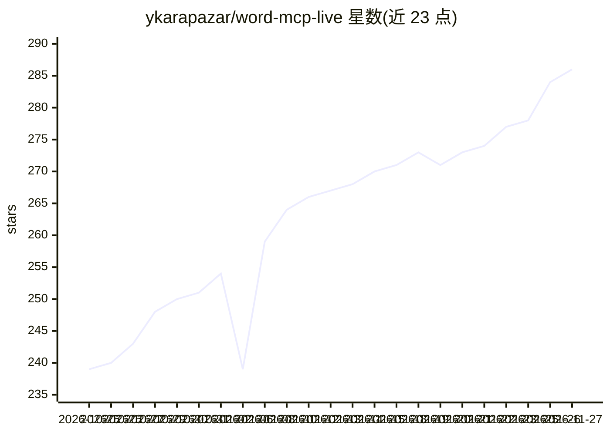

# ykarapazar/word-mcp-live

⭐ 286 · Python · MIT · 推送 2026-11-10 · [GitHub](https://github.com/ykarapazar/word-mcp-live) · 个人维护

**让 MCP AI 客户端在 Word 打开状态下直接编辑文档的 MCP 服务器**

一个面向支持 MCP 协议的 AI 客户端的服务器，提供 120 个工具操作 Microsoft Word 文档：跨平台模式基于 python-docx 创建/编辑 .docx，实时模式通过 Windows COM 或 macOS JXA 在文档打开状态下修改并产生真实修订记录与线程化评论，每个操作支持 Ctrl+Z 撤销。支持 stdio/SSE/HTTP 传输与 Docker 部署，本地运行、不采集数据。实时编辑依赖本机 Word，Docker 模式仅限跨平台工具。

## 筛选速览

| 维度 | 判定 | 备注 |
|---|---|---|
| AI 角色 | `ai-ecosystem` | LLM/agent 周边工具 |
| 许可风险 | `permissive` | MIT |
| 部署形态 | `library` | 以包/库形式分发 |
| 模型依赖 | — | README 未给出锁定关系 |
| 硬件要求 | — | 无带数字的原话,不猜 |
| 安装摩擦 | `low` | 无编译、无系统依赖或容器化 |
| 成熟度 | — | 结构信号不足 |

## 能力要点

- 120 个工具分两种模式：跨平台 75 个、Windows COM 实时 45 个、macOS JXA 实时 32 个
- 实时编辑：文档在 Word 中打开状态下修改，修订记录使用用户署名
- 每个 AI 操作单步可撤销（Ctrl+Z / per-operation undo）
- 支持 stdio、SSE、streamable-http 传输与 Claude Desktop/Cursor/VS Code 等客户端配置

## 适用场景

- 让 AI 起草合同并生成可供同事审阅的修订记录
- 让 AI 批量调整文档格式、标题编号与自动交叉引用
- 让 AI 以评论形式在指定段落提出审阅意见

## 场景标签

`AI 写作` · 领域:内容生成

## 证据(README 行号)

> L14: word-mcp-live gives any AI assistant that supports MCP full control of Microsoft Word. Open a document, tell the AI
> L149: ## Two Modes
> L187: |`MCP_TRANSPORT`|`stdio`|Transport type: `stdio`, `sse`, or `streamable-http`|

## 星数曲线

2026-10-25 239 → 2026-11-27 286（+47）

---
*卡片 v1 · prompt 1.4 · 生成 2026-11-25 · 置信度 high · 依据 README sha `adedf7861776` · [字段定义](../../DATASET.md)*
