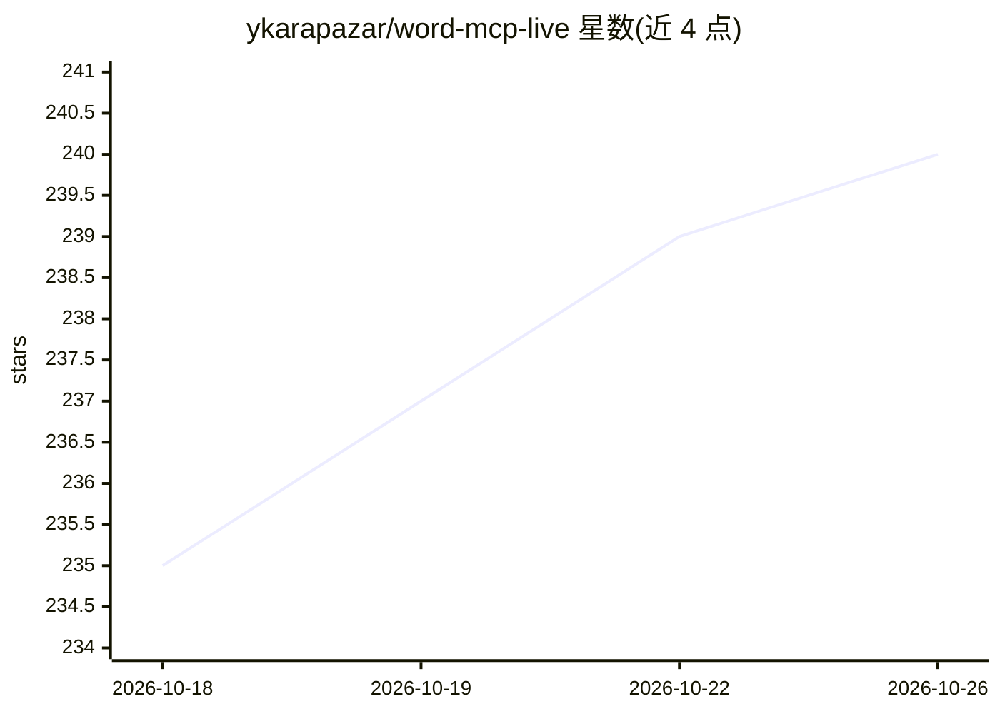

# ykarapazar/word-mcp-live

⭐ 240 · Python · MIT · 推送 2026-10-06 · [GitHub](https://github.com/ykarapazar/word-mcp-live) · 个人维护

**让 AI 助手直接编辑打开中 Word 文档的 MCP 服务器**

基于 Python 的 MCP 服务器，向支持 MCP 的 AI 客户端（Claude Desktop/Claude Code、Cursor、VS Code/Copilot、Windsurf）暴露 124 个 Word 操作工具：跨平台模式用 python-docx 读写 .docx；Live 模式通过 Windows COM 或 macOS JXA 在文档处于打开状态时实时编辑，支持原生修订（tracked changes）、逐操作撤销、线程化批注、公式与交叉引用等。Docker 模式仅支持跨平台工具。需 Python 3.11+，Live 模式需本机安装 Microsoft Word。

## 筛选速览

| 维度 | 判定 | 备注 |
|---|---|---|
| AI 角色 | `ai-ecosystem` | LLM/agent 周边工具 |
| 许可风险 | `permissive` | MIT |
| 部署形态 | `library` | 以包/库形式分发 |
| 模型依赖 | locked-api |  |
| 硬件要求 | — | 无带数字的原话,不猜 |
| 安装摩擦 | `low` | 无编译、无系统依赖或容器化 |
| 成熟度 | — | 结构信号不足 |

## 能力要点

- 124 个工具：80 个跨平台（python-docx）+ 44 个 Windows Live（COM）+ 40 个 macOS Live（JXA）
- 文档打开状态下实时编辑，无需保存-关闭-重开循环
- 原生 tracked changes（署名作者）与逐操作 Ctrl+Z 撤销
- 支持 stdio/sse/streamable-http 三种传输方式，可远程部署

## 适用场景

- 让 Claude/Cursor 等 AI 客户端直接代我格式化、修订 Word 文档
- 用自然语言起草带修订标记的合同供同事审阅
- 批量为保存的 .docx 文件做文档处理（跨平台模式）
- 让 AI 在指定段落添加批注提出问题

## 场景标签

`AI 写作` · 领域:内容生成

## 证据(README 行号)

> L14: word-mcp-live gives any AI assistant that supports MCP full control of Microsoft Word. Open a document, tell the AI
> L62: Add to your `claude_desktop_config.json`:

## 星数曲线

2026-10-18 235 → 2026-10-26 240（+5）

---
*卡片 v1 · prompt 1.4 · 生成 2026-10-22 · 置信度 high · 依据 README sha `7b411b958c82` · [字段定义](../../DATASET.md)*
