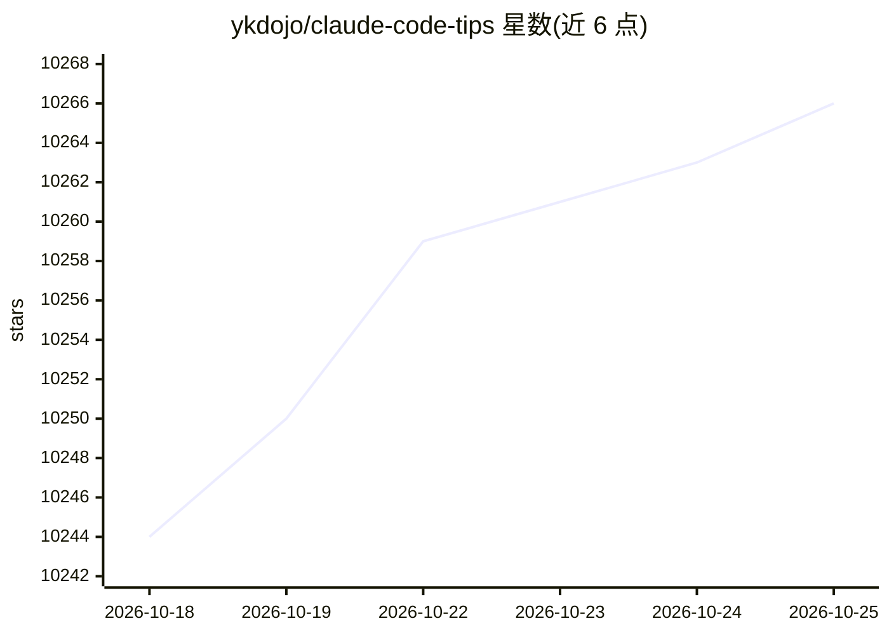

# ykdojo/claude-code-tips

⭐ 10,268 · HTML · NOASSERTION · 推送 2026-09-25 · [GitHub](https://github.com/ykdojo/claude-code-tips) · 个人维护

**45+ 条 Claude Code 使用技巧合集，附状态栏脚本与 dx 插件**

面向 Claude Code 用户的技巧清单（45+ 条，从基础到进阶），内容涵盖自定义状态栏脚本（显示模型、git 分支、token 用量进度条、10 种配色）、常用斜杠命令、本地语音转写输入、任务拆解方法、Git/GitHub CLI 工作流、上下文管理与终端别名等；并包含 Claude Code 在容器中运行自身的做法，以及面向日常开发工作流的 dx 技能插件。读者可按目录选取技巧应用到自己的 Claude Code 使用中。

## 筛选速览

| 维度 | 判定 | 备注 |
|---|---|---|
| AI 角色 | `ai-knowledge` | 知识聚合/清单类 |
| 许可风险 | `none` | NOASSERTION |
| 部署形态 | `self-host` | docker 或自建部署 |
| 模型依赖 | — | README 未给出锁定关系 |
| 硬件要求 | — | 无带数字的原话,不猜 |
| 安装摩擦 | `low` | 无编译、无系统依赖或容器化 |
| 成熟度 | — | 结构信号不足 |

## 能力要点

- 自定义状态栏脚本：模型、git 分支、未提交文件数、token 用量进度条
- 45+ 条技巧覆盖斜杠命令、语音输入、Git/GitHub CLI、上下文管理
- 包含 Claude Code 在容器中运行自身的示例
- 附带日常开发工作流的 dx 技能插件

## 适用场景

- 提升我使用 Claude Code 的效率，学习进阶工作流
- 配置状态栏以监控上下文 token 用量
- 参考语音输入与多 Claude 协作的工作流

## 场景标签

`精选清单` · 领域:学习与行业

## 证据(README 行号)

> L1: # 45+ Claude Code Tips: From Basics to Advanced
> L3: Here are my tips for getting the most out of Claude Code, including a custom status line script and Claude Code runn

## 星数曲线

2026-10-18 10,244 → 2026-10-25 10,266（+22）

---
*卡片 v1 · prompt 1.4 · 生成 2026-10-20 · 置信度 mid · 依据 README sha `e517109b269b` · [字段定义](../../DATASET.md)*
