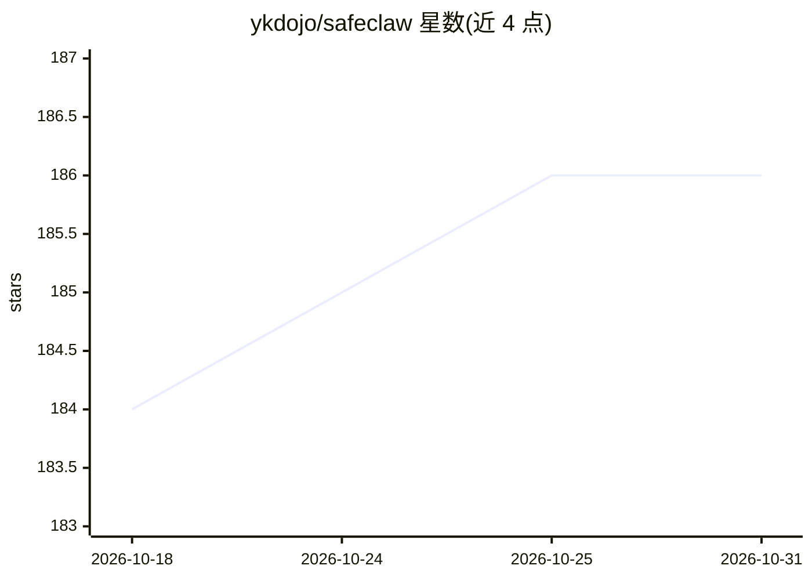

# ykdojo/safeclaw

⭐ 186 · HTML · MIT · 推送 2026-09-27 · [GitHub](https://github.com/ykdojo/safeclaw) · 个人维护

**容器化运行多个 Claude Code 会话并提供 Web 管理面板的工具**

面向使用 Claude Code 的开发者：每个 Claude Code 会话运行在独立 Docker 容器中，从而以 --dangerously-skip-permissions 方式运行而不影响宿主机，会话可在数秒内创建/停止/删除。镜像内置 Ubuntu 24.04、Node.js 24、GitHub CLI、Playwright MCP + Chromium、ttyd web 终端与 tmux 等。通过 build.sh/run.sh 脚本或 npm scripts 启动，网页面板（localhost:7680）统一管理会话，令牌存储于本地 .secrets 并以环境变量注入；会话历史与记忆经卷挂载持久化在宿主机。附带 Slack 只读、yt-dlp、gdoc 等技能。限制：需 Docker 与 Claude Code 认证令牌。

## 筛选速览

| 维度 | 判定 | 备注 |
|---|---|---|
| AI 角色 | `ai-ecosystem` | LLM/agent 周边工具 |
| 许可风险 | `permissive` | MIT |
| 部署形态 | `None` |  |
| 模型依赖 | — | README 未给出锁定关系 |
| 硬件要求 | — | 无带数字的原话,不猜 |
| 安装摩擦 | `low` | 无编译、无系统依赖或容器化 |
| 成熟度 | — | 结构信号不足 |

## 能力要点

- 每个 Claude Code 会话独立容器，互不干扰，秒级启停
- Web 面板管理会话：创建/启停/删除 + 实时 iframe 视图
- 会话历史与记忆经卷挂载持久化到宿主机 ~/.config/safeclaw
- 镜像内置 Playwright MCP + Chromium、GitHub CLI、ttyd + tmux

## 适用场景

- 并行运行多个 Claude Code 会话处理不同项目或研究任务
- 在隔离容器中以跳过权限模式安全运行 Claude Code
- 通过浏览器面板集中管理全部会话

## 场景标签

`编码 Agent` · 领域:编码与开发

## 证据(README 行号)

> L3: The easiest way to run multiple Claude Code sessions, each in its own container, with a dashboard to manage them all
> L19: Each Claude Code session runs in its own container. Spin up as many as you need - they're isolated from each other 

## 星数曲线

2026-10-18 184 → 2026-10-31 186（+2）

---
*卡片 v1 · prompt 1.4 · 生成 2026-10-22 · 置信度 high · 依据 README sha `18476efc3094` · [字段定义](../../DATASET.md)*
