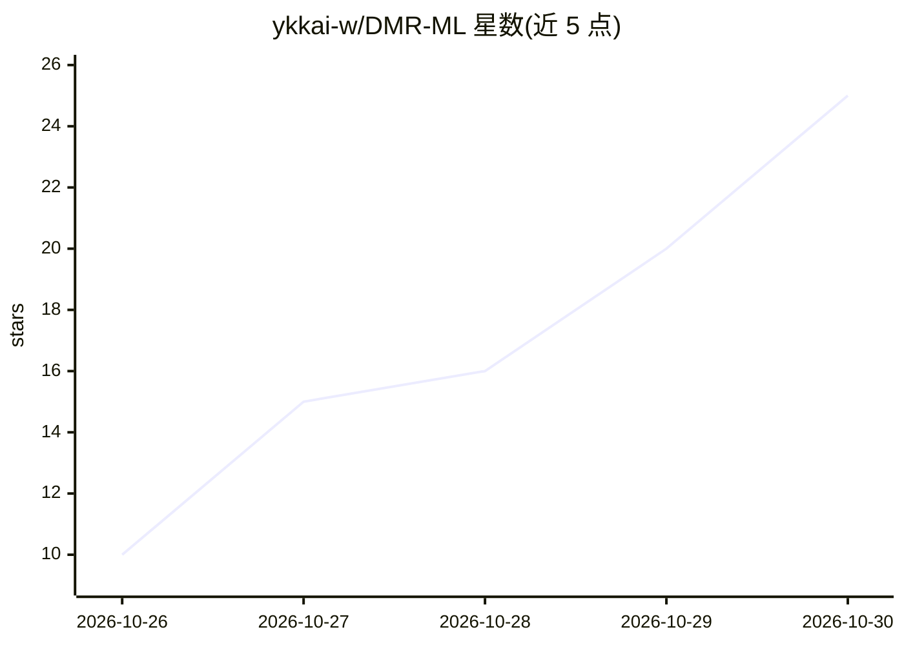

# ykkai-w/DMR-ML

⭐ 25 · Python · MIT · 推送 2026-09-24 · [GitHub](https://github.com/ykkai-w/DMR-ML) · [官网](https://dmrml.cn/) · 个人维护 · 中文 README

**给 A 股投资者的双动量轮动 + 机器学习风控量化系统**

在沪深 300 与中证 1000 之间做双重动量轮动，每次轮动前用随机森林分类器预测未来 5 个交易日下跌概率，双阈值迟滞机制（触发 40%/解除 33%）决定是否强制空仓。提供 FastAPI 后端 + 原生前端，含回测、今日信号、回撤分析等界面，数据源为 Tushare Pro，需注册获取 Token。Adagio/Presto/Rubato 三种参数预设。作者声明此仓库为初版、不再更新，最新版模型通过网站订阅获取每日信号；回测为样本内结果，声明不构成投资建议。

## 筛选速览

| 维度 | 判定 | 备注 |
|---|---|---|
| AI 角色 | `ai-native` | 本体是模型或模型工具 |
| 许可风险 | `permissive` | MIT |
| 部署形态 | `library` | 以包/库形式分发 |
| 模型依赖 | — | README 未给出锁定关系 |
| 硬件要求 | — | 无带数字的原话,不猜 |
| 安装摩擦 | `low` | 无编译、无系统依赖或容器化 |
| 成熟度 | `idea` | |

## 能力要点

- 双重动量轮动决定买什么，随机森林风险闸决定该不该买
- Purged Walk-Forward 验证，训练测试窗口留 gap 防数据泄露
- Adagio/Presto/Rubato 三种模型参数预设，前端可调参
- 支持 Web 界面、命令行回测与每日信号生成三种运行方式

## 适用场景

- 通过 ETF 低成本跟随沪深 300 与中证 1000 轮动策略
- 查看每日操作建议与 ML 风险概率做仓位决策
- 本地跑回测复现并调整策略参数做研究

## 场景标签

`金融量化` · 领域:学习与行业

## 证据(README 行号)

> L22: DMR-ML = DMR（双重动量轮动）+ ML（机器学习风险门禁）。前半段负责决定"买什么"，后半段负责判断"现在该不该买"。
> L24: 在沪深 300 与中证 1000 之间做动量轮动，并在每一次轮动前用一个随机森林分类器做风险评估：预测概率超过触发阈值时强制空仓，低于解除阈值时恢复持仓。
> L34: 随机森林分类器预测未来 5 个交易日的下跌概率。双阈值迟滞机制（默认触发 40% / 解除 33%）减少临界区间的频繁切换。

## 星数曲线

2026-10-26 10 → 2026-10-30 25（+15）

---
*卡片 v1 · prompt 1.4 · 生成 2026-10-28 · 置信度 mid · 依据 README sha `8109d5d890da` · [字段定义](../../DATASET.md)*
